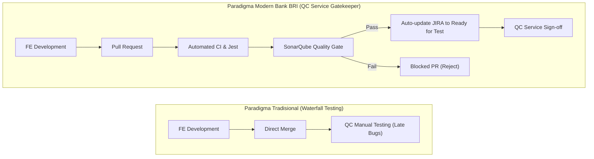
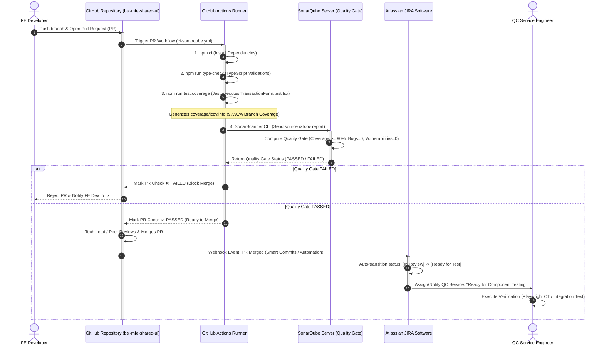
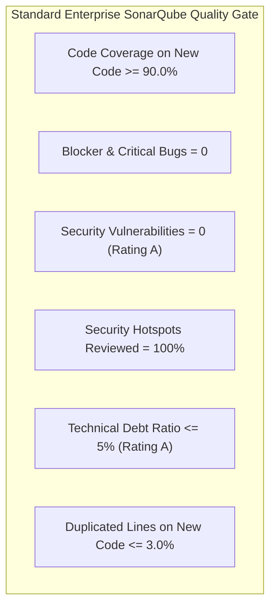

# Product Requirement Document (PRD) v1: Enterprise CI/CD Pipeline Architecture with SonarQube, Bank BRI GitLab/GitHub Hybrid Strategy, and Automated Jira SDLC

- **Document ID**: `PRD-BSI-MFE-CICD-001-V1`
- **Target Repository**: `bsi-mfe-shared-ui`
- **Component Under Test**: `src/components/form/transaction-form/TransactionForm.tsx`
- **Test Suite Reference**: `src/components/form/transaction-form/TransactionForm.test.tsx`
- **Linked Jira Ticket**: `BSI-SHARED-204`
- **Owner / Role**: QC Service (Quality Control / Quality Engineering) & DevOps Architecture / NeoCentra Bank (Ecosystem BSI & BRI)
- **Version**: `1.0.0`
- **Status**: Ready for Implementation
- **Target Environments**: GitHub Actions, Bank BRI On-Premise GitLab CI, SonarQube Enterprise, Jira Cloud / Jira Data Center

---

## 1. Executive Summary & Peran Strategis QC Service

### 1.1 Posisi QC Service dalam Siklus CI/CD Enterprise
Dalam paradigma pengembangan perangkat lunak perbankan modern (seperti di **Bank BRI** dan ekosistem **NeoCentra / BSI**), peran **QC Service (Quality Control / Quality Assurance)** telah berevolusi dari sekadar *"tester manual di akhir siklus"* menjadi **Quality Gatekeeper & Pipeline Guardian** (*Shift-Left Quality Engineering*).



Sebagai QC Service, tanggung jawab utama dalam pipeline ini mencakup:
1. **Menetapkan Quality Gate Threshold**: Menentukan batas minimum Code Coverage ($\ge 90\%$), batas toleransi Technical Debt, dan nol toleransi terhadap *Vulnerability* atau *Blocker Bugs*.
2. **Menjaga Integritas Komponen Finansial**: Memastikan komponen tier-0 seperti [`TransactionForm.tsx`](file:///Volumes/iwandev/neocentra-bank/bsi-mfe-shared-ui/src/components/form/transaction-form/TransactionForm.tsx) memiliki unit test yang valid di [`TransactionForm.test.tsx`](file:///Volumes/iwandev/neocentra-bank/bsi-mfe-shared-ui/src/components/form/transaction-form/TransactionForm.test.tsx) sebelum kode diizinkan masuk ke branch utama (`main`/`develop`).
3. **Mengotomatiskan Hand-off Tiket JIRA**: Menghilangkan inefisiensi komunikasi manual. Saat FE Dev membuat PR dan pipeline lolos validasi, status tiket JIRA otomatis bertransisi ke status **`Ready for Test`**, menandakan bahwa fitur telah siap diverifikasi oleh QC Service.

---

## 2. Arsitektur Enterprise: Bank BRI GitLab vs GitHub (Strategi Fork, Clone, dan Mirror)

### 2.1 Analisis Kondisi Realita di Bank BRI
Pada ekosistem perbankan Indonesia seperti Bank BRI:
* **Kebutuhan Regulasi & Keamanan (OJK & Bank Indonesia)**: Seluruh *intellectual property*, source code produksi, dan runner CI/CD utama wajib berada di dalam jaringan perbankan tertutup (*on-premise enterprise cloud* / VPC private) untuk mematuhi regulasi data kedaulatan finansial. Bank BRI umumnya menggunakan **GitLab Self-Hosted Enterprise Edition (EE)** yang terhubung dengan Kubernetes OpenShift, Harbor Registry, dan SonarQube on-premise.
* **Kondisi Repository Saat Ini**: Proyek Micro-Frontend `bsi-mfe-shared-ui` saat ini berada di repository **GitHub**.
* **Pertanyaan Utama**: *Dapatkah repository GitHub di-fork atau di-clone ke GitLab tanpa perlu membuat ulang dari awal, dan bagaimana arsitektur CI/CD-nya?*

### 2.2 Jawaban & Solusi Arsitektur: Dual-Repository Mirroring Strategy
> [!IMPORTANT]
> **Keputusan Arsitektur**: **SANGAT BISA**. Anda **TIDAK PERLU** membuat repository baru dari nol secara manual di GitLab.
> 
> Pendekatan standar industri perbankan untuk kondisi ini adalah **Repository Mirroring (GitHub $\leftrightarrow$ GitLab Synchronous Bridge)** atau **GitHub Actions with On-Premise SonarQube Runner**.

Terdapat 2 opsi arsitektur utama yang dapat diimplementasikan:

#### Opsi 1: Direct GitHub Actions + SonarQube (Cloud / Hybrid Bridge)
FE Dev bekerja di GitHub, Pull Request dieksekusi oleh GitHub Actions, dan hasil pengujian dikirimkan ke SonarQube (SonarCloud atau SonarQube on-premise Bank BRI melalui self-hosted runner/VPN gateway).



#### Opsi 2: GitLab CI/CD on-premise Bank BRI via Repository Mirroring
Jika kebijakan IT Governance Bank BRI mewajibkan pipeline *wajib 100%* dieksekusi di server internal BRI GitLab:
1. Di GitLab Bank BRI, buat Project baru via menu: **New Project $\rightarrow$ Run CI/CD for external repository $\rightarrow$ GitHub** (atau aktifkan **Repository Mirroring: Pull** di `Settings > Repository > Mirroring repositories`).
2. Setiap kali ada commit atau PR di GitHub, GitLab on-premise otomatis melakukan sinkronisasi (*pull mirror*).
3. Pipeline `.gitlab-ci.yml` internal BRI berjalan di atas GitLab Runner on-premise yang memiliki akses langsung ke SonarQube internal BRI.

---

## 3. Spesifikasi Pipeline CI/CD: Pull Request Trigger & SonarQube

### 3.1 Siklus Stage Pipeline
Setiap kali FE Dev melakukan push dan membuka Pull Request ke branch `main` atau `develop`, pipeline CI wajib menjalankan 5 tahapan berurutan (*fail-fast principle*):

| Tahap | Stage Name | Perintah / Action | Kriteria Keberhasilan |
|---|---|---|---|
| **Stage 1** | **Environment Setup** | `actions/checkout@v4`, `actions/setup-node@v4`, `npm ci` | Node.js v20/v22 terkonfigurasi, dependency terinstal dari `package-lock.json` tanpa modifikasi. |
| **Stage 2** | **Type Checking** | `npm run type-check` (`tsc --noEmit`) | Tidak ada kesalahan tipe TypeScript pada `TransactionForm.tsx` dan modul pendukung. |
| **Stage 3** | **Unit Testing & Coverage** | `npm run test:coverage` (`jest --coverage`) | - 16 Unit Test di [`TransactionForm.test.tsx`](file:///Volumes/iwandev/neocentra-bank/bsi-mfe-shared-ui/src/components/form/transaction-form/TransactionForm.test.tsx) terstruktur rapi sesuai standar AC (AC-01 s/d AC-05) dan lulus 100%.<br>- File laporan `coverage/lcov.info` terbuat.<br>- Coverage lokal memenuhi ambang batas 90% (aktual: 100%). |
| **Stage 4** | **SonarQube Scan** | `SonarSource/sonarqube-scan-action@v4` | Source code dan file `coverage/lcov.info` berhasil dianalisis dan dikirim ke server SonarQube. |
| **Stage 5** | **Quality Gate Gatekeeper** | `SonarSource/sonarqube-quality-gate-action@v1` | **PR Check Status**: Memblokir merge jika status `FAILED`, meloloskan jika `PASSED`. |

### 3.2 Standar SonarQube Quality Gate Bank BRI untuk Frontend Shared UI
Mengikuti standar tata kelola perangkat lunak perbankan tier-1:



* **Coverage on New Code**: $\ge 90.0\%$ (Kompilasi Jest pada `TransactionForm.tsx` saat ini menghasilkan **97.91% Branch Coverage** dan **100% Line/Statement Coverage**, sehingga memenuhi standar ini).
* **Security Rating**: **A** (0 OWASP Top 10 vulnerabilities, zero credential leak).
* **Reliability Rating**: **A** (0 bug logis).
* **Maintainability Rating**: **A** (Technical debt $\le 5\%$, code smell minimal).

---

## 4. Konfigurasi File Teknis (Production Ready)

### 4.1 File Konfigurasi: `sonar-project.properties`
File ini ditempatkan di root direktori `bsi-mfe-shared-ui/sonar-project.properties`.

```properties
# ====================================================================
# SonarQube Configuration for BSI MFE Shared UI (Bank BRI Ecosystem)
# ====================================================================

# Identitas Proyek di SonarQube
sonar.projectKey=bsi-mfe-shared-ui
sonar.projectName=BSI MFE Shared UI - NeoCentra Bank
sonar.projectVersion=1.0.0

# Encoding & Bahasa
sonar.sourceEncoding=UTF-8
sonar.language=ts

# Direktori Sumber Kode & Test
sonar.sources=src
sonar.tests=src

# Filter Spesifik Komponen & File Test
sonar.test.inclusions=src/**/*.test.tsx,src/**/*.test.ts,src/**/*.spec.tsx,src/**/*.spec.ts
sonar.inclusions=src/components/form/transaction-form/**/*

# Pengecualian Laporan Coverage (Hanya fokus pada komponen fungsional yang diekspos)
sonar.coverage.exclusions=\
  src/test/**/*,\
  src/router/**/*,\
  src/public/**/*,\
  src/**/*.stories.tsx,\
  src/**/*.types.ts,\
  src/**/index.ts,\
  webpack.config.js,\
  jest.config.js,\
  babel.config.json

# Lokasi Laporan Hasil Eksekusi Unit Test & Coverage dari Jest
sonar.javascript.lcov.reportPaths=coverage/lcov.info

# Parameter Integrasi Pull Request (Otomatis diisi oleh CI Runner)
sonar.qualitygate.wait=true
sonar.qualitygate.timeout=300
```

---

### 4.2 File Workflow GitHub Actions: `.github/workflows/ci-sonarqube.yml`
Pipeline otomasi saat FE Dev melakukan push dan membuat Pull Request di GitHub.

```yaml
name: "CI Pipeline: SonarQube Quality Gate & Unit Test Coverage"

on:
  pull_request:
    branches:
      - main
      - develop
    paths:
      - 'src/**'
      - 'package.json'
      - 'package-lock.json'
      - 'jest.config.js'
      - 'tsconfig.json'
  push:
    branches:
      - main
      - develop

jobs:
  code-quality-and-test:
    name: "Jest Test & SonarQube Quality Gate"
    runs-on: ubuntu-latest
    timeout-minutes: 15

    steps:
      - name: "1. Checkout Source Code"
        uses: actions/checkout@v4
        with:
          fetch-depth: 0 # Full history diperlukan untuk analisis blame SonarQube

      - name: "2. Setup Node.js Environment"
        uses: actions/setup-node@v4
        with:
          node-version: 20
          cache: 'npm'

      - name: "3. Install Dependencies (Clean Install)"
        run: npm ci

      - name: "4. TypeScript Type-Checking"
        run: npm run type-check

      - name: "5. Execute Jest Unit Tests with Coverage"
        run: npm run test:coverage
        env:
          CI: true

      - name: "6. Verify LCOV Coverage Report Exists"
        run: |
          if [ ! -f coverage/lcov.info ]; then
            echo "ERROR: coverage/lcov.info not found! Jest failed to generate coverage."
            exit 1
          fi
          echo "LCOV coverage report verified successfully."

      - name: "7. SonarQube Scan"
        uses: SonarSource/sonarqube-scan-action@v4
        env:
          SONAR_TOKEN: ${{ secrets.SONAR_TOKEN }}
          SONAR_HOST_URL: ${{ secrets.SONAR_HOST_URL }} # e.g. https://sonar.bri.co.id atau SonarQube Cloud
        with:
          args: >
            -Dsonar.pullrequest.key=${{ github.event.pull_request.number }}
            -Dsonar.pullrequest.branch=${{ github.head_ref }}
            -Dsonar.pullrequest.base=${{ github.base_ref }}

      - name: "8. SonarQube Quality Gate Check"
        uses: SonarSource/sonarqube-quality-gate-action@v1
        timeout-minutes: 5
        env:
          SONAR_TOKEN: ${{ secrets.SONAR_TOKEN }}
          SONAR_HOST_URL: ${{ secrets.SONAR_HOST_URL }}
```

---

### 4.3 File Pipeline GitLab CI on-premise BRI: `.gitlab-ci.yml`
Jika repository di-mirror ke GitLab internal Bank BRI:

```yaml
# ====================================================================
# Bank BRI GitLab CI Pipeline - BSI MFE Shared UI
# ====================================================================

stages:
  - validate
  - test
  - sonarqube
  - notify-jira

variables:
  NODE_ENV: "test"
  SONAR_USER_HOME: "${CI_PROJECT_DIR}/.sonar"
  GIT_DEPTH: "0"

cache:
  key: ${CI_COMMIT_REF_SLUG}
  paths:
    - node_modules/
    - .sonar/cache

# Stage 1: Validate TypeScript & Dependencies
lint_and_typecheck:
  stage: validate
  image: node:20-alpine
  script:
    - npm ci
    - npm run type-check
  only:
    - merge_requests
    - main
    - develop

# Stage 2: Execute Jest & Generate Coverage
unit_testing:
  stage: test
  image: node:20-alpine
  script:
    - npm ci
    - npm run test:coverage
  artifacts:
    name: "coverage-report-${CI_COMMIT_SHORT_SHA}"
    expire_in: 7 days
    paths:
      - coverage/
    reports:
      junit: junit.xml
  coverage: '/All files[^|]*\|[^|]*\s+([\d\.]+)/'
  only:
    - merge_requests
    - main
    - develop

# Stage 3: SonarQube Scanner on-premise BRI
sonarqube_scan:
  stage: sonarqube
  image:
    name: sonarsource/sonar-scanner-cli:latest
    entrypoint: [""]
  dependencies:
    - unit_testing
  script:
    - sonar-scanner
        -Dsonar.host.url="${SONAR_HOST_URL}"
        -Dsonar.token="${SONAR_TOKEN}"
        -Dsonar.qualitygate.wait=true
  only:
    - merge_requests
    - main
    - develop

# Stage 4: Automate Jira Transition when MR is Merged
jira_update_to_ready_for_test:
  stage: notify-jira
  image: curlimages/curl:latest
  script:
    - echo "Updating Jira ticket status to Ready for Test..."
    - |
      # Ekstrak Jira Key dari commit message atau nama branch (e.g. BSI-SHARED-204)
      JIRA_ISSUE_KEY=$(echo "${CI_COMMIT_REF_NAME}" | grep -o -E '[A-Z]+-[0-9]+' | head -n 1)
      if [ -n "$JIRA_ISSUE_KEY" ]; then
        curl -s -X POST \
          -H "Authorization: Basic ${JIRA_API_BASIC_AUTH}" \
          -H "Content-Type: application/json" \
          --data '{"transition": {"id": "41"}}' \
          "${JIRA_BASE_URL}/rest/api/3/issue/${JIRA_ISSUE_KEY}/transitions"
        echo "Jira issue ${JIRA_ISSUE_KEY} transitioned to Ready for Test."
      else
        echo "No Jira issue key detected in branch ${CI_COMMIT_REF_NAME}."
      fi
  only:
    - main
    - develop
  when: on_success
```

---

## 5. Otomasi Siklus Agile Scrum di JIRA untuk QC Service

### 5.1 Alur Transisi Status Tiket JIRA

```mermaid
stateDiagram-v2
    [*] --> ToDo: Sprint Planning (BSI-SHARED-204)
    ToDo --> InProgress: FE Dev mulai buat branch
    InProgress --> InReview: FE Dev buka Pull Request (PR)
    
    state InReview {
        [*] --> CI_Running: GitHub Actions Triggered
        CI_Running --> Jest_Passed: Unit Test OK (Coverage >= 90%)
        Jest_Passed --> Sonar_Check: SonarQube Scanner Running
        Sonar_Check --> Gate_Passed: Quality Gate Status PASSED
        Sonar_Check --> Gate_Failed: Quality Gate FAILED
        Gate_Failed --> [*]: Blocked PR (Reject)
    }

    InReview --> ReadyForTest: PR Merged to Develop (Auto-Transition)
    
    state ReadyForTest {
        note right of ReadyForTest
            Pekerjaan Utama QC Service:
            1. Verifikasi Xray Cucumber Test
            2. Eksekusi Playwright Component Test
            3. Verifikasi Logika Keuangan & Idempotensi
        end note
    }

    ReadyForTest --> InTesting: QC Service mulai validasi
    InTesting --> Done: QC Sign-Off & DoD Terpenuhi
    InTesting --> Reopened: Bug Ditemukan (Return to In Progress)
    Done --> [*]
```

### 5.2 Implementasi Otomasi JIRA: Atlassian Jira Automation Rule (Native No-Code)
Di JIRA Project (`BSI-SHARED`), QC Service atau Scrum Master mengaktifkan **Jira Automation Rule** melalui menu: `Project Settings > Automation > Create Rule`:

#### Spesifikasi Rule JIRA Automation:
1. **Trigger**: `DevOps: Pull request merged` (dari GitHub for Jira / GitLab DVCS Connector)
2. **Condition**: 
   - `Issue type` equals `Story` / `Task` / `Bug`
   - `Status` equals `In Review` atau `In Progress`
3. **Action 1 (Transition Issue)**:
   - Ubah status tiket menjadi: **`Ready for Test`** (atau `Ready for QA`).
4. **Action 2 (Reassign / Mention)**:
   - Ubah Assignee ke: **`QC Service Team`** (atau tambahkan mention di comment).
5. **Action 3 (Add Comment)**:
   ```markdown
   🤖 *[Automated CI/CD Notification]*
   Pull Request #${pullRequest.id} telah berhasil di-merge ke branch `${pullRequest.destinationBranch}`.
   
   ✅ **SonarQube Quality Gate**: PASSED
   📊 **Unit Test Coverage**: >= 90% (File: `TransactionForm.test.tsx`)
   🎯 **Assignee Dialihkan**: @QC-Service-Engineer
   
   Tiket ini sekarang berada pada status *Ready for Test*. Silakan QC Service melanjutkan pengujian Component Test & Xray Scenario Sign-Off.
   ```

### 5.3 Alternatif: JIRA Smart Commits oleh FE Dev
FE Dev juga dapat memanfaatkan fitur **Smart Commits** bawaan Atlassian saat melakukan commit atau merge PR:

```bash
# Format: <JIRA_KEY> #<COMMAND> <COMMENT>
git commit -m "BSI-SHARED-204 #ready-for-test #comment [FE Dev] PR #14 merged to develop. Unit test coverage: 97.91%. Passed SonarQube Quality Gate."
```

---

## 6. Standard Operating Procedure (SOP): Kolaborasi FE Dev dan QC Service

### 6.1 Alur Kerja FE Developer (Shift-Left)
1. **Pengambilan Tiket**: FE Dev mengambil tiket `BSI-SHARED-204` di JIRA dan memindahkan status ke `In Progress`.
2. **Pembuatan Branch**: Mengikuti konvensi penamaan branch standar Bank BRI:
   ```bash
   git checkout -b feature/BSI-SHARED-204-transaction-form
   ```
3. **Pengembangan & Unit Testing Lokal**:
   - Menulis komponen di [`TransactionForm.tsx`](file:///Volumes/iwandev/neocentra-bank/bsi-mfe-shared-ui/src/components/form/transaction-form/TransactionForm.tsx).
   - Menulis unit test di [`TransactionForm.test.tsx`](file:///Volumes/iwandev/neocentra-bank/bsi-mfe-shared-ui/src/components/form/transaction-form/TransactionForm.test.tsx).
   - Menjalankan test lokal:
     ```bash
     npm run test:coverage
     ```
   - Memastikan tidak ada error TypeScript:
     ```bash
     npm run type-check
     ```
4. **Push & Buat Pull Request (PR)**:
   - Membuka PR ke branch `develop` dengan format judul: `[BSI-SHARED-204] Implementasi Reusable TransactionForm & Unit Tests`.
   - CI Pipeline berjalan otomatis. FE Dev memantau status SonarQube Quality Gate di GitHub checks tab.
   - Jika Quality Gate hijau dan PR disetujui Tech Lead, PR di-merge.

### 6.2 Alur Kerja QC Service (Quality Sign-Off)
1. **Notifikasi Otomatis**: QC Service menerima notifikasi JIRA bahwa tiket `BSI-SHARED-204` telah bertransisi menjadi `Ready for Test`.
2. **Audit Hasil CI/CD**:
   - QC Service memeriksa dashboard SonarQube proyek `bsi-mfe-shared-ui`:
     - Memastikan coverage `TransactionForm.tsx` berada di atas target $90\%$ (aktual: **$97.91\%$**).
     - Memastikan 0 Security Vulnerabilities dan 0 Code Smells.
3. **Eksekusi Pengujian Tingkat Lanjut**:
   - Menjalankan test case Xray BDD Gherkin (`TC-XRAY-001` s/d `TC-XRAY-005` sesuai dokumen `v2-testing-form-component.md`).
   - Menjalankan Playwright Component Testing (`npm run test:ct`).
4. **Sign-off Tiket JIRA**:
   - Jika seluruh skenario lolos: Ubah status tiket menjadi **`Done`** (atau `Ready for UAT`).
   - Jika ditemukan bug: Buka issue tipe `Bug` atau ubah status tiket kembali ke `In Progress` dengan lampiran log failure.

---

## 7. Penanganan Skenario Kegagalan (Failure Handling & Recovery)

| Skenario Kegagalan | Penyebab Teknis | Tindakan Korektif FE Dev / QC |
|---|---|---|
| **Coverage < 90% di SonarQube** | Terdapat branch logic baru di `TransactionForm.tsx` yang belum dicakup oleh test suite di `TransactionForm.test.tsx`. | PR diblokir otomatis. FE Dev menambahkan unit test case spesifik untuk branch yang belum ter-cover hingga coverage mencapai minimal $90\%$. |
| **TypeScript Type-Check Error** | Inkonsistensi props pada `TransactionFormProps` atau generic event typing. | Pipeline gagal di Stage 2. FE Dev memperbaiki tipe data lokal dan menjalankan `npm run type-check` sebelum melakukan push ulang. |
| **SonarQube Token Expired / Unreachable** | Secret `SONAR_TOKEN` kedaluwarsa atau server SonarQube internal BRI sedang maintenance / VPN terputus. | Pipeline gagal di Stage 4. DevOps/QC memperbarui token di GitHub Repository Secrets (`Settings > Secrets and variables > Actions`). |
| **Tiket JIRA Gagal Berpindah Status** | Nama branch atau commit message tidak mencantumkan Issue Key (misal: `BSI-SHARED-204`). | QC Service mengingatkan FE Dev untuk selalu menggunakan konvensi penamaan standar bank, atau melakukan transisi manual sekali sambil memperbaiki branch name. |

---

## 8. Checklist Definition of Done (DoD) untuk CI/CD Pipeline

- [ ] File `sonar-project.properties` telah dibuat di root proyek `bsi-mfe-shared-ui`.
- [ ] File workflow GitHub Actions `.github/workflows/ci-sonarqube.yml` terkonfigurasi dan lolos sintaks linter.
- [ ] Secret repository `SONAR_TOKEN` dan `SONAR_HOST_URL` telah ditambahkan di pengaturan repositori.
- [ ] Script unit test `npm run test:coverage` menghasilkan file `coverage/lcov.info` yang valid.
- [ ] SonarQube Quality Gate dikonfigurasi dengan ambang batas Coverage New Code $\ge 90\%$.
- [ ] Aturan branch protection diaktifkan di GitHub: Pull Request wajib lulus pemeriksaan SonarQube sebelum diperbolehkan merge.
- [ ] Integrasi JIRA Automation Rule aktif: PR Merged otomatis mengubah status issue ke `Ready for Test` untuk QC Service.
- [x] Seluruh 16 unit test pada [`TransactionForm.test.tsx`](file:///Volumes/iwandev/neocentra-bank/bsi-mfe-shared-ui/src/components/form/transaction-form/TransactionForm.test.tsx) lulus evaluasi pipeline dengan standar traceability AC.

