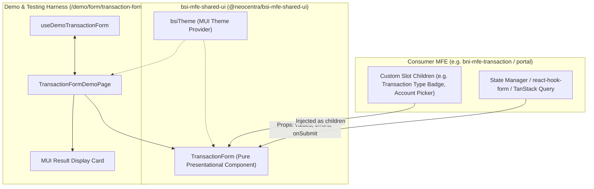

# Product Requirement Document (PRD): v1 Reusable Transaction Form Component

- **Document ID**: `PRD-BSI-MFE-UI-001`
- **Component Name**: `v1-reusable-component-prd`
- **Target Repository**: `bsi-mfe-shared-ui`
- **File Location**: `bsi-mfe-shared-ui/prd/v1-reusable-component-prd.md`
- **Component Target**: `bsi-mfe-shared-ui/src/components/form/TransactionForm.tsx`
- **Owner**: Frontend Core Architecture / NeoCentra Bank
- **Version**: `1.0.0`
- **Status**: Ready for Implementation

---

## 1. Latar Belakang & Tujuan (Background & Objective)

### 1.1 Latar Belakang
Pada implementasi sebelumnya di Micro-Frontend (MFE) transaksi (`bni-mfe-transaction/src/components/TransactionForm.tsx`), komponen formulir transaksi masih bersifat monolitik dan terikat erat (*tightly-coupled*) dengan *business logic*, hooks spesifik (`useTransaction`), schema validasi Zod internal, dan pemanggilan mutasi API TanStack Query. 

Hal ini menghambat portabilitas komponen ke micro-frontend lain di ekosistem NeoCentra Bank (seperti portal BSI, portal transfer, maupun consumer MFE lainnya) yang membutuhkan UI form transaksi konsisten namun memiliki kebutuhan alur data, validasi, maupun variasi metadata transaksi yang berbeda.

### 1.2 Tujuan
1. **Sentralisasi UI Reusable**: Mengekstrak UI form transaksi dari `bni-mfe-transaction/src/components/TransactionForm.tsx:L38-L183` ke `bsi-mfe-shared-ui/src/components/form/TransactionForm.tsx` sebagai *pure presentational / controlled component*.
2. **Inversion of Control (IoC) via Slotting / Children**: Mengganti blok statis jenis transaksi (`L81-L116`) dengan slot `children` props agar consumer MFE memiliki fleksibilitas penuh untuk menyisipkan komponen kustom (seperti pemilih jenis transaksi Debit/Kredit, pemilihan rekening sumber, info saldo, dsb.) tepat di atas input nominal.
3. **Type-Safe Contract**: Menyediakan antarmuka TypeScript yang jelas, komprehensif, dan deklaratif untuk nilai formulir, pesan error, loading state, dan event handlers.
4. **Theme Standard**: Mengintegrasikan seluruh styling dengan tema BSI (`bsiTheme.ts`) berbasis Material-UI (MUI) yang mencakup palet warna hijau khas BSI (`#1B5E20`), sudut membulat (*border radius* 16px untuk Card, 24px untuk Button), dan tipografi Roboto.
5. **Interactive Demo & Testing Harness**: Menyediakan route demo terisolasi (`/demo/form/transaction-form`) lengkap dengan custom hook (`useDemoTransactionForm`) dan MUI Card penampil hasil input secara visual untuk memvalidasi interaktivitas sebelum dikonsumsi oleh MFE lain.

---

## 2. Cakupan & Batasan (Scope & Boundaries)

### 2.1 In-Scope
- Migrasi dan refactoring struktur card form (`L38-L183`) ke `bsi-mfe-shared-ui`.
- Mengganti blok baris `L81-L116` dengan `children?: React.ReactNode`.
- Mendukung integrasi *controlled component* melalui props:
  - Nilai form (`values`: `amount`, `description`).
  - Penanganan error validasi (`errors`: `amount`, `description`).
  - Status proses / submit (`isLoading`, `disabled`, `submitText`, `loadingText`).
  - Callback events (`onChange`, `onSubmit`, `onAmountChange`, `onDescriptionChange`).
- Implementasi demo route `/demo/form/transaction-form` di aplikasi `bsi-mfe-shared-ui`.
- Implementasi custom hook simulasi `useDemoTransactionForm`.
- Implementasi panel hasil input formulir menggunakan Material-UI `Card`.
- Penggunaan styling dan komponen terstandardisasi dari `src/theme/bsiTheme.ts`.

### 2.2 Out-of-Scope
- Pemanggilan API HTTP / Axios / GraphQL langsung di dalam komponen `TransactionForm` shared UI (tanggung jawab consumer MFE).
- Global snackbar notification internal di dalam shared UI (komponen hanya menyediakan callback/state, consumer bebas menentukan cara menampilkan snackbar).
- Konfigurasi autentikasi / JWT / header idempotency (dikelola oleh service layer masing-masing consumer MFE).

---

## 3. Spesifikasi Fungsional (Functional Requirements)

| ID | Modul | Kebutuhan Fungsional | Prioritas |
|---|---|---|---|
| **FR-01** | `TransactionForm` | Komponen wajib merender container form berbentuk Material-UI `Card` dengan header judul ("Formulir Transaksi"), ikon bank, dan subjudul bank yang dapat dikustomisasi via props. | **P0** |
| **FR-02** | `TransactionForm` | Menghapus blok hardcoded jenis transaksi (`L81-L116`) dan menggantinya dengan slot `children` props sehingga consumer dapat menginjeksi komponen custom di atas field nominal. | **P0** |
| **FR-03** | `TransactionForm` | Menyediakan field input **Nominal (Amount)** bertipe angka, dengan start adornment mata uang ("Rp"), format error/helper text, dan penanganan nilai non-negatif. | **P0** |
| **FR-04** | `TransactionForm` | Menyediakan field input **Keterangan (Description)** bertipe teks multiline (3 baris) dengan placeholder deklaratif dan error state. | **P0** |
| **FR-05** | `TransactionForm` | Menyediakan tombol submit berukuran besar (`size="large"`) dengan visual state loading (`CircularProgress`) dan teks tombol yang dapat dikonfigurasi. | **P0** |
| **FR-06** | `Demo Route` | Menyediakan rute URL `/demo/form/transaction-form` (dengan fallback router) untuk menguji rendering dan interaksi form. | **P1** |
| **FR-07** | `Demo Hook` | Membuat custom hook `useDemoTransactionForm` untuk mengelola form state, validasi, simulasi delay async submit, dan reset nilai. | **P1** |
| **FR-08** | `Demo Result Card` | Menampilkan Material-UI `Card` visual di samping atau di bawah form yang memuat ringkasan data yang diinputkan user secara terstruktur dan terformat rapi. | **P1** |

---

## 4. Arsitektur Teknis & Komponen

### 4.1 Diagram Alur Komponen & Konsumen



---

### 4.2 Analisis Refactoring Baris Kode Asal

| Kode Asal (`bni-mfe-transaction`) | Status di `bsi-mfe-shared-ui` | Alasan & Transformasi |
|---|---|---|
| **L38-L72**: Outer Box, Card, CardContent, Header Icon, Judul | **Diadaptasi & Distandarkan** | Dipertahankan strukturnya, teks judul dan subjudul dijadikan props dengan default value ("Formulir Transaksi", "Bank Syariah Indonesia"). |
| **L81-L116**: Blok Hardcoded `Jenis Transaksi` (Badge DEBIT / CREDIT) | **DIHAPUS & DIGANTI `children`** | Dihilangkan dari file komponen utama. Digantikan oleh `{children}` di bawah header dan sebelum field `Nominal`. Consumer dapat memasang jenis transaksi atau komponen lain secara modular. |
| **L119-L145**: Input Nominal (`amount`) | **Dibuat Generic Controlled** | Dihapus ketergantungan terhadap `<Controller />` react-hook-form bawaan. Menggunakan props `values.amount`, `errors.amount`, dan callback `onChange` / `onAmountChange`. |
| **L148-L163**: Input Keterangan (`description`) | **Dibuat Generic Controlled** | Dihapus ketergantungan terhadap `<Controller />`. Menggunakan props `values.description`, `errors.description`, dan callback `onChange` / `onDescriptionChange`. |
| **L166-L180**: Submit Button & CircularProgress | **Dibuat Generic Controlled** | Menggunakan props `isLoading`, `disabled`, `submitText`, `loadingText`, dan callback form `onSubmit`. |
| **L185-L200**: Snackbar | **Dikeluarkan dari Komponen** | Feedback notification dipisahkan agar reusable component tidak mengatur global modal/snackbar stack. |

---

### 4.3 Kontrak Tipe TypeScript (`TransactionForm.types.ts`)

```typescript
import React from 'react';
import { SxProps, Theme } from '@mui/material';

export interface TransactionFormValues {
  amount: number | string;
  description: string;
}

export interface TransactionFormErrors {
  amount?: string;
  description?: string;
}

export interface TransactionFormProps {
  /**
   * Nilai formulir saat ini
   */
  values: TransactionFormValues;

  /**
   * Pesan error validasi per-field
   */
  errors?: TransactionFormErrors;

  /**
   * Status loading saat proses submit sedang berjalan
   * @default false
   */
  isLoading?: boolean;

  /**
   * Status disable untuk seluruh form dan submit button
   * @default false
   */
  disabled?: boolean;

  /**
   * Teks pada tombol submit saat kondisi normal
   * @default "Kirim Transaksi"
   */
  submitText?: string;

  /**
   * Teks pada tombol submit saat kondisi loading
   * @default "Memproses..."
   */
  loadingText?: string;

  /**
   * Judul formulir pada header
   * @default "Formulir Transaksi"
   */
  title?: string;

  /**
   * Subjudul pada header
   * @default "Bank Syariah Indonesia"
   */
  subtitle?: string;

  /**
   * Custom adornment mata uang pada field nominal
   * @default "Rp"
   */
  currencyPrefix?: string;

  /**
   * Slot komponen kustom pengganti baris L81-L116.
   * Digunakan oleh consumer untuk menyisipkan badge tipe transaksi,
   * pemilihan akun, atau info nasabah di atas input nominal.
   */
  children?: React.ReactNode;

  /**
   * Slot footer opsional di bawah tombol submit (e.g. disclaimer, tombol batal)
   */
  footer?: React.ReactNode;

  /**
   * Kustomisasi styling Card MUI
   */
  cardSx?: SxProps<Theme>;

  /**
   * Kustomisasi styling outer container Box
   */
  containerSx?: SxProps<Theme>;

  /**
   * Sembunyikan header icon & title jika consumer ingin membuat custom header sendiri
   * @default false
   */
  hideHeader?: boolean;

  /**
   * Callback ketika field berubah secara umum
   */
  onChange?: (field: keyof TransactionFormValues, value: any) => void;

  /**
   * Callback spesifik ketika nilai nominal berubah
   */
  onAmountChange?: (value: number) => void;

  /**
   * Callback spesifik ketika nilai keterangan berubah
   */
  onDescriptionChange?: (value: string) => void;

  /**
   * Callback saat form di-submit
   */
  onSubmit: (e?: React.FormEvent<HTMLFormElement>) => void;
}
```

---

### 4.4 Implementasi Komponen Inti (`TransactionForm.tsx`)

Lokasi file: `bsi-mfe-shared-ui/src/components/form/TransactionForm.tsx`

```tsx
import React from 'react';
import {
  Box,
  Card,
  CardContent,
  Typography,
  TextField,
  Button,
  InputAdornment,
  CircularProgress,
} from '@mui/material';
import AccountBalanceIcon from '@mui/icons-material/AccountBalance';
import { TransactionFormProps } from './TransactionForm.types';

export default function TransactionForm({
  values,
  errors = {},
  isLoading = false,
  disabled = false,
  submitText = 'Kirim Transaksi',
  loadingText = 'Memproses...',
  title = 'Formulir Transaksi',
  subtitle = 'Bank Syariah Indonesia',
  currencyPrefix = 'Rp',
  children,
  footer,
  cardSx,
  containerSx,
  hideHeader = false,
  onChange,
  onAmountChange,
  onDescriptionChange,
  onSubmit,
}: TransactionFormProps) {
  const handleAmountChange = (e: React.ChangeEvent<HTMLInputElement>) => {
    const rawValue = e.target.value;
    const numValue = rawValue === '' ? 0 : Number(rawValue);

    if (onAmountChange) {
      onAmountChange(numValue);
    }
    if (onChange) {
      onChange('amount', numValue);
    }
  };

  const handleDescriptionChange = (e: React.ChangeEvent<HTMLInputElement>) => {
    const textValue = e.target.value;

    if (onDescriptionChange) {
      onDescriptionChange(textValue);
    }
    if (onChange) {
      onChange('description', textValue);
    }
  };

  const handleSubmit = (e: React.FormEvent<HTMLFormElement>) => {
    e.preventDefault();
    if (!isLoading && !disabled) {
      onSubmit(e);
    }
  };

  return (
    <Box
      sx={{
        width: '100%',
        display: 'flex',
        alignItems: 'center',
        justifyContent: 'center',
        p: { xs: 2, sm: 3 },
        ...containerSx,
      }}
    >
      <Card
        sx={{
          width: '100%',
          maxWidth: 480,
          ...cardSx,
        }}
      >
        <CardContent sx={{ p: { xs: 3, sm: 4 } }}>
          {/* Header */}
          {!hideHeader && (
            <Box
              sx={{
                display: 'flex',
                flexDirection: 'column',
                alignItems: 'center',
                mb: 3,
              }}
            >
              <Box
                sx={{
                  width: 64,
                  height: 64,
                  borderRadius: '50%',
                  bgcolor: 'primary.main',
                  display: 'flex',
                  alignItems: 'center',
                  justifyContent: 'center',
                  mb: 1.5,
                  boxShadow: '0 4px 12px rgba(27, 94, 32, 0.25)',
                }}
              >
                <AccountBalanceIcon sx={{ color: '#FFFFFF', fontSize: 32 }} />
              </Box>
              <Typography
                variant="h5"
                sx={{ fontWeight: 700, color: 'primary.main', textAlign: 'center' }}
              >
                {title}
              </Typography>
              {subtitle && (
                <Typography
                  variant="body2"
                  color="text.secondary"
                  sx={{ textAlign: 'center', mt: 0.5 }}
                >
                  {subtitle}
                </Typography>
              )}
            </Box>
          )}

          {/* Form Content */}
          <Box
            component="form"
            onSubmit={handleSubmit}
            noValidate
            sx={{ display: 'flex', flexDirection: 'column', gap: 2.5 }}
          >
            {/* Slot Children: Pengganti Baris L81-L116 untuk Custom Component di Atas Input */}
            {children && <Box sx={{ width: '100%' }}>{children}</Box>}

            {/* Input Nominal (Amount) */}
            <TextField
              label="Nominal"
              type="number"
              fullWidth
              disabled={disabled || isLoading}
              value={values.amount === 0 ? '' : values.amount}
              error={Boolean(errors.amount)}
              helperText={errors.amount}
              onChange={handleAmountChange}
              slotProps={{
                input: {
                  startAdornment: (
                    <InputAdornment position="start">{currencyPrefix}</InputAdornment>
                  ),
                },
                htmlInput: { min: 0 },
              }}
            />

            {/* Input Keterangan (Description) */}
            <TextField
              label="Keterangan"
              multiline
              rows={3}
              fullWidth
              disabled={disabled || isLoading}
              value={values.description}
              error={Boolean(errors.description)}
              helperText={errors.description}
              placeholder="Masukkan keterangan transaksi..."
              onChange={handleDescriptionChange}
            />

            {/* Tombol Submit Transaksi */}
            <Button
              type="submit"
              variant="contained"
              fullWidth
              size="large"
              disabled={disabled || isLoading}
              sx={{ mt: 1 }}
              startIcon={
                isLoading ? (
                  <CircularProgress size={20} color="inherit" />
                ) : undefined
              }
            >
              {isLoading ? loadingText : submitText}
            </Button>

            {/* Optional Footer Slot */}
            {footer && <Box sx={{ mt: 1 }}>{footer}</Box>}
          </Box>
        </CardContent>
      </Card>
    </Box>
  );
}
```

---

## 5. Spesifikasi Demo & Testing Harness

### 5.1 Route Demo URL
- **Rute URL**: `/demo/form/transaction-form`
- **Tujuan**: Memungkinkan developer dan QA menguji form secara interaktif di lingkungan lokal `bsi-mfe-shared-ui` (port 3235).
- **Mekanisme Routing**:
  - `webpack.config.js` sudah mendukung `devServer: { historyApiFallback: true }`.
  - Aplikasi `bsi-mfe-shared-ui` dapat menggunakan router sederhana (atau pathname dispatcher) yang memetakan `window.location.pathname === '/demo/form/transaction-form'` ke halaman demo `TransactionFormDemoPage`.

---

### 5.2 Custom Hook Demo (`useDemoTransactionForm.ts`)

Lokasi file: `bsi-mfe-shared-ui/src/hooks/useDemoTransactionForm.ts`

Tanggung jawab hook:
1. Menyimpan state nilai formulir (`values`: `amount`, `description`).
2. Menyimpan state pilihan jenis transaksi demo (`transactionType`: `'DEBIT' | 'CREDIT'`).
3. Menyimpan pesan error validasi per-field.
4. Mensimulasikan delay asynchronous (misal 1200ms) saat tombol submit ditekan.
5. Menyimpan data transaksi terakhir yang sukses disubmit (`lastSubmittedData`) untuk ditampilkan di Material UI Result Card.

```typescript
import { useState, useCallback } from 'react';
import {
  TransactionFormValues,
  TransactionFormErrors,
} from '../components/form/TransactionForm.types';

export type DemoTransactionType = 'DEBIT' | 'CREDIT';

export interface SubmittedTransactionRecord {
  id: string;
  type: DemoTransactionType;
  amount: number;
  description: string;
  timestamp: string;
}

export function useDemoTransactionForm() {
  const [transactionType, setTransactionType] =
    useState<DemoTransactionType>('DEBIT');

  const [values, setValues] = useState<TransactionFormValues>({
    amount: 150000,
    description: 'Pembayaran tagihan listrik & internet',
  });

  const [errors, setErrors] = useState<TransactionFormErrors>({});
  const [isLoading, setIsLoading] = useState<boolean>(false);
  const [submittedData, setSubmittedData] =
    useState<SubmittedTransactionRecord | null>(null);

  const validate = useCallback(
    (currentValues: TransactionFormValues): boolean => {
      const newErrors: TransactionFormErrors = {};
      const numAmount = Number(currentValues.amount);

      if (!numAmount || isNaN(numAmount) || numAmount <= 0) {
        newErrors.amount = 'Nominal transaksi harus lebih besar dari Rp 0';
      }

      if (!currentValues.description || currentValues.description.trim().length < 3) {
        newErrors.description = 'Keterangan transaksi minimal 3 karakter';
      }

      setErrors(newErrors);
      return Object.keys(newErrors).length === 0;
    },
    [],
  );

  const handleFieldChange = useCallback(
    (field: keyof TransactionFormValues, val: any) => {
      setValues((prev) => {
        const updated = { ...prev, [field]: val };
        // Clear error saat user mengetik
        if (errors[field]) {
          setErrors((errPrev) => ({ ...errPrev, [field]: undefined }));
        }
        return updated;
      });
    },
    [errors],
  );

  const handleAmountChange = useCallback((amount: number) => {
    handleFieldChange('amount', amount);
  }, [handleFieldChange]);

  const handleDescriptionChange = useCallback((description: string) => {
    handleFieldChange('description', description);
  }, [handleFieldChange]);

  const handleSubmit = useCallback(
    (e?: React.FormEvent) => {
      if (e) e.preventDefault();

      const isValid = validate(values);
      if (!isValid) return;

      setIsLoading(true);

      // Simulasi delay asynchronous network call (1.2 detik)
      setTimeout(() => {
        const newRecord: SubmittedTransactionRecord = {
          id: `TRX-${Date.now().toString().slice(-6)}`,
          type: transactionType,
          amount: Number(values.amount),
          description: values.description.trim(),
          timestamp: new Date().toLocaleTimeString('id-ID', {
            hour: '2-digit',
            minute: '2-digit',
            second: '2-digit',
          }),
        };

        setSubmittedData(newRecord);
        setIsLoading(false);
      }, 1200);
    },
    [values, transactionType, validate],
  );

  const handleReset = useCallback(() => {
    setValues({ amount: '', description: '' });
    setErrors({});
    setSubmittedData(null);
  }, []);

  return {
    transactionType,
    setTransactionType,
    values,
    errors,
    isLoading,
    submittedData,
    handleFieldChange,
    handleAmountChange,
    handleDescriptionChange,
    handleSubmit,
    handleReset,
  };
}
```

---

### 5.3 Komponen Demo Page & Hasil Input Card (`TransactionFormDemoPage.tsx`)

Lokasi file: `bsi-mfe-shared-ui/src/pages/demo/TransactionFormDemoPage.tsx`

Tampilan demo mencakup:
1. **Background**: Mengikuti gradient BSI `linear-gradient(135deg, #1B5E20 0%, #2E7D32 50%, #388E3C 100%)`.
2. **Left Panel / Form Card**: Memuat komponen `TransactionForm`.
3. **Injected Children (Slot L81-L116)**:
   - Diberikan radio selector atau button chips untuk berganti jenis transaksi: **DEBIT** vs **CREDIT**.
   - Tampilan badge status dengan ikon `TrendingDownIcon` (merah untuk DEBIT) dan `TrendingUpIcon` (hijau untuk CREDIT), sesuai desain asli L81-L116 namun kini diatur bebas oleh consumer/demo.
4. **Right Panel / Result Display Card**:
   - Membungkus data hasil input formulir ke dalam Material-UI `Card`.
   - Menampilkan Chip jenis transaksi, nominal terformat Rupiah (`Intl.NumberFormat('id-ID')`), teks keterangan, ID transaksi simulasi, dan timestamp submit.
   - Menyediakan tombol "Reset Form & Data".

```tsx
import React from 'react';
import {
  Box,
  Card,
  CardContent,
  Typography,
  Chip,
  Divider,
  Button,
  RadioGroup,
  FormControlLabel,
  Radio,
  Paper,
  Stack,
} from '@mui/material';
import TrendingDownIcon from '@mui/icons-material/TrendingDown';
import TrendingUpIcon from '@mui/icons-material/TrendingUp';
import CheckCircleOutlineIcon from '@mui/icons-material/CheckCircleOutline';
import InfoOutlinedIcon from '@mui/icons-material/InfoOutlined';
import TransactionForm from '../../components/form/TransactionForm';
import { useDemoTransactionForm } from '../../hooks/useDemoTransactionForm';

export default function TransactionFormDemoPage() {
  const {
    transactionType,
    setTransactionType,
    values,
    errors,
    isLoading,
    submittedData,
    handleAmountChange,
    handleDescriptionChange,
    handleSubmit,
    handleReset,
  } = useDemoTransactionForm();

  const formatRupiah = (val: number) => {
    return new Intl.NumberFormat('id-ID', {
      style: 'currency',
      currency: 'IDR',
      minimumFractionDigits: 0,
    }).format(val);
  };

  return (
    <Box
      sx={{
        minHeight: '100vh',
        background:
          'linear-gradient(135deg, #1B5E20 0%, #2E7D32 50%, #388E3C 100%)',
        p: { xs: 2, md: 4 },
        display: 'flex',
        flexDirection: 'column',
        alignItems: 'center',
        justifyContent: 'center',
        gap: 3,
      }}
    >
      {/* Demo Page Banner */}
      <Paper
        elevation={0}
        sx={{
          py: 1,
          px: 3,
          borderRadius: 4,
          bgcolor: 'rgba(255, 255, 255, 0.15)',
          backdropFilter: 'blur(10px)',
          color: '#FFFFFF',
          display: 'flex',
          alignItems: 'center',
          gap: 1.5,
        }}
      >
        <InfoOutlinedIcon fontSize="small" />
        <Typography variant="subtitle2" sx={{ fontWeight: 600 }}>
          Interactive Demo: <code>/demo/form/transaction-form</code> (Testing Reusable Component)
        </Typography>
      </Paper>

      {/* Main Grid: Form di Kiri/Atas & Result Card di Kanan/Bawah */}
      <Stack
        direction={{ xs: 'column', md: 'row' }}
        spacing={3}
        sx={{
          width: '100%',
          maxWidth: 1024,
          alignItems: 'stretch',
          justifyContent: 'center',
        }}
      >
        {/* Kolom 1: Reusable Transaction Form */}
        <Box sx={{ flex: 1, display: 'flex', justifyContent: 'center' }}>
          <TransactionForm
            values={values}
            errors={errors}
            isLoading={isLoading}
            onAmountChange={handleAmountChange}
            onDescriptionChange={handleDescriptionChange}
            onSubmit={handleSubmit}
            containerSx={{ p: 0 }}
          >
            {/* INJECTED CHILDREN (Slot Pengganti L81-L116) */}
            <Box
              sx={{
                p: 1.5,
                borderRadius: 2,
                bgcolor: 'background.default',
                border: '1px dashed',
                borderColor: 'divider',
                mb: 0.5,
              }}
            >
              <Typography
                variant="caption"
                color="text.secondary"
                sx={{ display: 'block', mb: 1, fontWeight: 700 }}
              >
                KOMPONEN CONSUMER: PILIH JENIS TRANSAKSI
              </Typography>

              <RadioGroup
                row
                value={transactionType}
                onChange={(e) =>
                  setTransactionType(e.target.value as 'DEBIT' | 'CREDIT')
                }
              >
                <FormControlLabel
                  value="DEBIT"
                  control={<Radio size="small" color="error" />}
                  label={
                    <Box sx={{ display: 'flex', alignItems: 'center', gap: 0.5 }}>
                      <TrendingDownIcon fontSize="small" color="error" />
                      <Typography variant="body2" sx={{ fontWeight: 600, color: 'error.main' }}>
                        DEBIT
                      </Typography>
                    </Box>
                  }
                />
                <FormControlLabel
                  value="CREDIT"
                  control={<Radio size="small" color="success" />}
                  label={
                    <Box sx={{ display: 'flex', alignItems: 'center', gap: 0.5 }}>
                      <TrendingUpIcon fontSize="small" color="success" />
                      <Typography variant="body2" sx={{ fontWeight: 600, color: 'success.main' }}>
                        CREDIT
                      </Typography>
                    </Box>
                  }
                />
              </RadioGroup>
            </Box>
          </TransactionForm>
        </Box>

        {/* Kolom 2: Material UI Card Hasil Input Value */}
        <Box sx={{ flex: 1, display: 'flex', justifyContent: 'center' }}>
          <Card
            sx={{
              width: '100%',
              maxWidth: 480,
              display: 'flex',
              flexDirection: 'column',
              boxShadow: '0 8px 32px rgba(0, 0, 0, 0.2)',
            }}
          >
            <CardContent sx={{ p: 4, flex: 1, display: 'flex', flexDirection: 'column' }}>
              <Box sx={{ display: 'flex', alignItems: 'center', gap: 1.5, mb: 2 }}>
                <CheckCircleOutlineIcon color="primary" sx={{ fontSize: 28 }} />
                <Typography variant="h6" sx={{ fontWeight: 700 }}>
                  Live Form Output
                </Typography>
              </Box>
              <Typography variant="body2" color="text.secondary" sx={{ mb: 2 }}>
                Data berikut menunjukkan nilai real-time dari props dan hasil submit yang ditangkap oleh consumer.
              </Typography>

              <Divider sx={{ mb: 2.5 }} />

              {/* Status Submit Card */}
              {submittedData ? (
                <Box
                  sx={{
                    p: 2,
                    mb: 2,
                    borderRadius: 2,
                    bgcolor: 'success.lighter',
                    border: '1px solid',
                    borderColor: 'success.light',
                  }}
                >
                  <Typography variant="subtitle2" sx={{ color: 'success.dark', fontWeight: 700 }}>
                    Transaksi Berhasil Disimulasikan!
                  </Typography>
                  <Typography variant="caption" sx={{ color: 'text.secondary' }}>
                    ID: {submittedData.id} • Pukul: {submittedData.timestamp}
                  </Typography>
                </Box>
              ) : (
                <Box
                  sx={{
                    p: 2,
                    mb: 2,
                    borderRadius: 2,
                    bgcolor: 'grey.100',
                    border: '1px dashed',
                    borderColor: 'grey.400',
                  }}
                >
                  <Typography variant="body2" color="text.secondary">
                    Belum ada transaksi yang disubmit. Silakan isi form dan klik <strong>Kirim Transaksi</strong>.
                  </Typography>
                </Box>
              )}

              {/* Data Preview Table/List */}
              <Stack spacing={1.5} sx={{ mb: 3 }}>
                <Box sx={{ display: 'flex', justifyContent: 'space-between', alignItems: 'center' }}>
                  <Typography variant="body2" color="text.secondary">
                    Tipe Transaksi (Slot):
                  </Typography>
                  <Chip
                    size="small"
                    icon={
                      transactionType === 'DEBIT' ? (
                        <TrendingDownIcon fontSize="small" />
                      ) : (
                        <TrendingUpIcon fontSize="small" />
                      )
                    }
                    label={transactionType}
                    color={transactionType === 'DEBIT' ? 'error' : 'success'}
                    variant="outlined"
                  />
                </Box>

                <Box sx={{ display: 'flex', justifyContent: 'space-between', alignItems: 'center' }}>
                  <Typography variant="body2" color="text.secondary">
                    Nominal Terisi:
                  </Typography>
                  <Typography variant="subtitle1" sx={{ fontWeight: 700, color: 'primary.main' }}>
                    {values.amount ? formatRupiah(Number(values.amount)) : 'Rp 0'}
                  </Typography>
                </Box>

                <Box>
                  <Typography variant="body2" color="text.secondary" sx={{ mb: 0.5 }}>
                    Keterangan Terisi:
                  </Typography>
                  <Paper
                    variant="outlined"
                    sx={{
                      p: 1.5,
                      bgcolor: 'background.default',
                      minHeight: 64,
                    }}
                  >
                    <Typography variant="body2" sx={{ fontStyle: values.description ? 'normal' : 'italic' }}>
                      {values.description || 'Belum ada keterangan...'}
                    </Typography>
                  </Paper>
                </Box>
              </Stack>

              <Box sx={{ mt: 'auto', pt: 2 }}>
                <Button
                  variant="outlined"
                  color="inherit"
                  fullWidth
                  onClick={handleReset}
                  disabled={isLoading}
                >
                  Reset Form & Data
                </Button>
              </Box>
            </CardContent>
          </Card>
        </Box>
      </Stack>
    </Box>
  );
}
```

---

## 6. Integrasi Tema BSI (`bsiTheme.ts`)

Seluruh komponen shared-ui dan demo wajib menggunakan theme yang telah dikonfigurasi di `bsi-mfe-shared-ui/src/theme/bsiTheme.ts`.

### 6.1 Karakteristik Tema BSI
1. **Palet Warna**:
   - `primary.main`: `#1B5E20` (Hijau Utama BSI).
   - `primary.light`: `#4C8C4A`.
   - `secondary.main`: `#F9A825` (Aksen Kuning/Emas BSI).
   - `background.default`: `#F5F5F0`.
2. **Kustomisasi Komponen MUI**:
   - `MuiButton`: `borderRadius: 24`, `fontWeight: 700`, `textTransform: 'none'`, padding `10px 24px`.
   - `MuiCard`: `borderRadius: 16`, `boxShadow: '0 4px 20px rgba(0, 0, 0, 0.12)'`.
   - `MuiTextField`: `variant: 'outlined'`.
3. **Penerapan Theme di Entry Point (`App.tsx` & `index.tsx`)**:

```tsx
// src/App.tsx
import React from 'react';
import { ThemeProvider } from '@mui/material/styles';
import CssBaseline from '@mui/material/CssBaseline';
import bsiTheme from './theme/bsiTheme';
import TransactionFormDemoPage from './pages/demo/TransactionFormDemoPage';

export default function App() {
  return (
    <ThemeProvider theme={bsiTheme}>
      <CssBaseline />
      <TransactionFormDemoPage />
    </ThemeProvider>
  );
}
```

---

## 7. Panduan Implementasi Consumer (`bni-mfe-transaction`)

Berikut adalah contoh bagaimana consumer (`bni-mfe-transaction`) mengadopsi `TransactionForm` yang telah direfaktor bersama dengan `react-hook-form` dan `useTransaction`:

```tsx
import React from 'react';
import { Box, Typography } from '@mui/material';
import TrendingDownIcon from '@mui/icons-material/TrendingDown';
import TrendingUpIcon from '@mui/icons-material/TrendingUp';
import { TransactionForm } from 'bsi-mfe-shared-ui';
import { useTransaction } from '../hooks/useTransaction';
import { TransactionParams } from '../pages/MfeTransaction';

export default function ConsumerTransactionPage({ type }: TransactionParams) {
  const { control, handleSubmit, onSubmit, mutation, snackbar, closeSnackbar, formState } =
    useTransaction({ type });

  const transactionType = type?.toUpperCase() as 'CREDIT' | 'DEBIT';

  return (
    <Box
      sx={{
        minHeight: '100vh',
        display: 'flex',
        alignItems: 'center',
        justifyContent: 'center',
        background: 'linear-gradient(135deg, #1B5E20 0%, #2E7D32 50%, #388E3C 100%)',
        p: 2,
      }}
    >
      <TransactionForm
        values={{
          amount: control._formValues.amount,
          description: control._formValues.description,
        }}
        errors={{
          amount: formState.errors.amount?.message,
          description: formState.errors.description?.message,
        }}
        isLoading={mutation.isPending}
        onSubmit={handleSubmit(onSubmit)}
        onAmountChange={(val) => control._formValues.amount = val}
        onDescriptionChange={(val) => control._formValues.description = val}
      >
        {/* Consumer menginjeksi komponen tipe transaksi asli via children slot */}
        <Box sx={{ mb: 1 }}>
          <Typography variant="body2" sx={{ fontWeight: 600, mb: 1 }}>
            Jenis Transaksi
          </Typography>
          <Box
            sx={{
              display: 'inline-flex',
              alignItems: 'center',
              gap: 1,
              px: 1.5,
              py: 0.75,
              borderRadius: 1.5,
              bgcolor: transactionType === 'DEBIT' ? '#FFEBEE' : '#E8F5E9',
              border: '1px solid',
              borderColor: transactionType === 'DEBIT' ? '#EF9A9A' : '#A5D6A7',
              color: transactionType === 'DEBIT' ? 'error.main' : 'success.main',
            }}
          >
            {transactionType === 'DEBIT' ? (
              <TrendingDownIcon fontSize="small" />
            ) : (
              <TrendingUpIcon fontSize="small" />
            )}
            <Typography variant="subtitle2" sx={{ fontWeight: 700 }}>
              {transactionType ?? '-'}
            </Typography>
          </Box>
        </Box>
      </TransactionForm>
    </Box>
  );
}
```

---

## 8. Struktur Direktori Lengkap (`bsi-mfe-shared-ui`)

Rencana struktur file di dalam `bsi-mfe-shared-ui`:

```text
bsi-mfe-shared-ui/
├── prd/
│   └── v1-reusable-component-prd.md           # Dokumen PRD ini
├── public/
│   └── index.html
├── src/
│   ├── components/
│   │   └── form/
│   │       ├── TransactionForm.tsx            # Komponen form reusable utama
│   │       ├── TransactionForm.types.ts      # Definisi interface TypeScript
│   │       └── index.ts                       # Re-export barrel file
│   ├── hooks/
│   │   ├── useDemoTransactionForm.ts          # Custom hook untuk demo & testing
│   │   └── index.ts
│   ├── pages/
│   │   └── demo/
│   │       └── TransactionFormDemoPage.tsx    # Halaman demo & Card output
│   ├── theme/
│   │   └── bsiTheme.ts                        # Material UI Theme BSI
│   ├── utils/
│   │   └── mui-prefix.ts
│   ├── App.css
│   ├── App.tsx                                # Root entry dengan demo routing
│   └── index.tsx                              # Webpack DOM render entry
├── babel.config.json
├── package.json
├── tsconfig.json
└── webpack.config.js
```

---

## 9. Kriteria Keberterimaan (Acceptance Criteria & Definition of Done)

- [ ] **AC-01 (Component Independence)**: File `TransactionForm.tsx` di `bsi-mfe-shared-ui` berdiri sendiri tanpa ketergantungan pada backend API, react-query, atau service axios internal.
- [ ] **AC-02 (Children Slotting)**: Baris hardcoded jenis transaksi (`L81-L116`) telah dihapus dan diganti dengan `{children}` props yang terbukti dapat menerima komponen eksternal.
- [ ] **AC-03 (Type Safety)**: Seluruh props didefinisikan menggunakan TypeScript (`TransactionFormProps`) dan lulus pemeriksaan `npm run type-check` tanpa error.
- [ ] **AC-04 (Theme Compliance)**: Menggunakan tema `bsiTheme.ts` untuk warna hijau `#1B5E20`, border radius card 16px, dan border radius button 24px.
- [ ] **AC-05 (Demo Route & Live Card)**: Halaman demo dapat dibuka pada route `/demo/form/transaction-form` atau root, form dapat diinput, tombol submit memicu loading simulasi via `useDemoTransactionForm`, dan nilai input muncul di Material-UI Result Card.
- [ ] **AC-06 (Export Barrel)**: Komponen dan tipenya diekspor dengan rapi melalui `src/index.tsx` atau `src/components/form/index.ts` agar siap dipublish/dikonsumsi antar-MFE via Webpack Module Federation / npm package.

