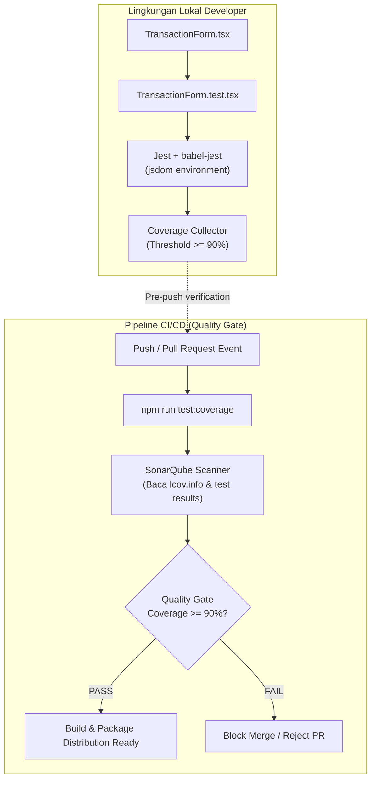

# Product Requirement Document (PRD): Automated Unit Testing for TransactionForm Component

- **Document ID**: `PRD-BSI-MFE-TEST-001`
- **Component Name**: `v1-testing-form-component-prd`
- **Target Repository**: `bsi-mfe-shared-ui`
- **File Location**: `bsi-mfe-shared-ui/prd/v1-testing-form-component-prd.md`
- **Component Target**: `bsi-mfe-shared-ui/src/components/form/TransactionForm.tsx`
- **Owner**: Frontend Core Architecture & Quality Engineering / NeoCentra Bank
- **Version**: `1.0.0`
- **Status**: Ready for Implementation

---

## 1. Latar Belakang & Tujuan (Background & Objective)

### 1.1 Latar Belakang
Komponen `TransactionForm` (`bsi-mfe-shared-ui/src/components/form/TransactionForm.tsx`) adalah komponen inti (*Tier-0 Exposed Component*) yang dirancang untuk didistribusikan dan digunakan oleh berbagai Micro-Frontend (MFE) transaksi di ekosistem NeoCentra Bank (seperti BNI dan BSI).

Pada standar industri enterprise perbankan (khususnya BUMN), setiap komponen reusable yang berinteraksi dengan alur finansial wajib memiliki jaminan stabilitas tinggi melalui pengujian otomatis (*automated testing*). Validasi tidak boleh hanya mengandalkan pengecekan manual di halaman demo lokal, melainkan harus diverifikasi di tingkat kode (*shift-left testing*) sebelum kode di-push dan diaudit oleh SonarQube Quality Gate pada pipeline CI/CD.

Selain itu, arsitektur build di `bsi-mfe-shared-ui` mengadopsi prinsip minimalis berbasis Webpack dan Babel murni tanpa menambahkan build engine pihak ketiga baru (seperti Vite/Vitest). Oleh karena itu, pengujian harus menggunakan test runner standar industri yang terintegrasi secara langsung dengan ekosistem Babel yang sudah ada: **Jest** dan **React Testing Library**.

### 1.2 Tujuan
1. **Penyediaan Infrastruktur Testing Murni Babel**: Mengonfigurasi Jest dan React Testing Library yang memanfaatkan konfigurasi `babel.config.json` dan `tsconfig.json` yang sudah ada tanpa konflik dengan Webpack.
2. **Fokus pada Komponen Ter-expose**: Mengarahkan eksekusi pengujian dan perhitungan metrik coverage secara eksklusif ke komponen yang akan didistribusikan, yaitu `src/components/form/TransactionForm.tsx`.
3. **Standar Coverage Enterprise (Minimal 90%)**: Menjamin seluruh branch logika, statement, function, dan line pada `TransactionForm` teruji dengan target ambang batas (*threshold*) minimal **90%** (target ideal: 95% - 100%).
4. **Validasi Perilaku Berbasis Pengguna (Behavior-Driven)**: Menguji interaksi komponen dari kacamata pengguna (input nominal, keterangan, klik submit, pencegahan double submission saat loading, status disabled, dan injeksi slot `children`) sesuai prinsip `@testing-library/react`.

---

## 2. Cakupan & Batasan (Scope & Boundaries)

### 2.1 In-Scope
1. **Konfigurasi Testing Framework**:
   - Instalasi paket Jest, `@types/jest`, `babel-jest`, `jest-environment-jsdom`, `@testing-library/react`, `@testing-library/jest-dom`, dan `@testing-library/user-event`.
   - Pembuatan file konfigurasi `jest.config.js`.
   - Pembuatan setup file `src/test/setupTests.ts` untuk registrasi matcher `@testing-library/jest-dom`.
   - Pembuatan utility test helper `src/test/test-utils.tsx` untuk membungkus komponen yang di-test dengan `ThemeProvider` (`bsiTheme`).
2. **Pengujian Komponen Inti (`TransactionForm.test.tsx`)**:
   - Pengujian *rendering default* (Header, Adornment Rupiah, Form input, Tombol submit).
   - Pengujian kustomisasi header (`title`, `subtitle`, `hideHeader`).
   - Pengujian Inversion of Control (IoC) via `children` slot dan `footer` slot.
   - Pengujian controlled inputs (`amount` dan `description`) serta pemanggilan callback `onChange`, `onAmountChange`, dan `onDescriptionChange`.
   - Pengujian kondisi error validasi (`errors.amount`, `errors.description`).
   - Pengujian proteksi aksi submit saat kondisi `isLoading` atau `disabled`.
3. **Automasi Script & Quality Gate**:
   - Penambahan script NPM di `package.json`:
     - `npm test`: Menjalankan seluruh test suite.
     - `npm run test:watch`: Menjalankan test dalam mode interaktif/watch.
     - `npm run test:coverage`: Menghasilkan laporan coverage lengkap (lcov/text) dengan penegakan threshold minimum 90%.

### 2.2 Out-of-Scope
- Pengujian halaman demo (`TransactionFormDemoPage.tsx`) dan router aplikasi demo (`src/router`).
- Pengujian End-to-End (E2E) browser nyata via Cypress atau Playwright.
- Pengujian integrasi langsung dengan backend API perbankan.

---

## 3. Arsitektur Teknis Automated Testing

### 3.1 Diagram Alur Eksekusi Testing & CI/CD Pipeline



### 3.2 Pemilihan & Peran Paket Testing

| Paket | Versi Rekomendasi | Peran Utama |
|---|---|---|
| `jest` | `^29.7.0` | Test runner, assertion framework (`expect`, `describe`, `it`), mock engine (`jest.fn()`). |
| `@types/jest` | `^29.5.14` | Type definitions TypeScript untuk matcher dan lifecycle Jest. |
| `babel-jest` | `^29.7.0` | Transformer pengubah kode TypeScript & JSX menggunakan `babel.config.json` bawaan project. |
| `jest-environment-jsdom` | `^29.7.0` | Headless browser DOM simulation di lingkungan Node.js. |
| `@testing-library/react` | `^16.2.0` | Utilities perenderan komponen React ke dalam jsdom. |
| `@testing-library/jest-dom` | `^6.6.3` | Matcher deklaratif khusus DOM (seperti `.toBeInTheDocument()`, `.toBeDisabled()`). |
| `@testing-library/user-event` | `^14.6.1` | Simulasi interaksi pengguna realistis (ketik keyboard, klik tombol, event sequence). |
| `identity-obj-proxy` | `^3.0.0` | Mocking import file CSS/styling agar Jest tidak gagal mem-parsing asset non-JS. |

---

## 4. Matriks Kasus Uji (Test Matrix)

Pengujian harus mencakup seluruh cabang percabangan (*branches*) pada baris kode `TransactionForm.tsx`:

| ID Test | Kategori | Skenario Pengujian | Target Branch / Prop yang Diuji | Ekspektasi Hasil |
|---|---|---|---|---|
| **TC-01** | Rendering | Render default dengan konfigurasi minimum | `title`, `subtitle`, `currencyPrefix`, `values` | Header default "Formulir Transaksi" & "Bank Syariah Indonesia" muncul, currency "Rp" ter-render, nilai nominal & keterangan terisi sesuai prop. |
| **TC-02** | Rendering | Render nominal dengan nilai 0 (zero) | `values.amount === 0 ? '' : values.amount` | Field nominal bernilai string kosong `""` saat `amount === 0`, bukan angka 0 telanjang. |
| **TC-03** | Header | Sembunyikan header | `hideHeader = true` | Elemen ikon bank, judul, dan subjudul tidak di-render di dalam DOM. |
| **TC-04** | Header | Kustomisasi teks header & subjudul kosong | `title="Kustom Title"`, `subtitle=""` | Judul menampilkan teks kustom, elemen subjudul tidak ter-render. |
| **TC-05** | Slotting | Injeksi komponen kustom pada slot `children` | `children` prop (Pengganti L81-L116) | Elemen anak (seperti radio DEBIT/CREDIT atau pemilih rekening) ter-render di atas field nominal. |
| **TC-06** | Slotting | Injeksi komponen pada slot `footer` | `footer` prop | Elemen footer (seperti catatan keamanan atau tombol batal) ter-render di bawah tombol submit. |
| **TC-07** | Input Event | Pengubahan nilai nominal transaksi | `handleAmountChange` -> `onAmountChange` & `onChange` | Saat user mengetik angka `500000`, `onAmountChange(500000)` dan `onChange('amount', 500000)` terpanggil. |
| **TC-08** | Input Event | Pengosongan nilai nominal transaksi | `handleAmountChange` (rawValue === '') | Saat input dihapus hingga kosong, `onAmountChange(0)` dan `onChange('amount', 0)` terpanggil. |
| **TC-09** | Input Event | Pengubahan teks keterangan transaksi | `handleDescriptionChange` -> `onDescriptionChange` & `onChange` | Saat user mengetik teks, `onDescriptionChange` dan `onChange('description', ...)` terpanggil dengan string yang sesuai. |
| **TC-10** | Error State | Menampilkan pesan error validasi per-field | `errors.amount` & `errors.description` | Input Nominal dan Keterangan berada pada visual state error (`aria-invalid="true"`), dan helper text pesan error muncul di layar. |
| **TC-11** | Submission | Submit formulir pada kondisi normal | `handleSubmit` -> `onSubmit` | Form submit event dipanggil (`e.preventDefault()` tereksekusi) dan callback `onSubmit` terpanggil tepat 1 kali. |
| **TC-12** | Protection | Proteksi submit saat kondisi `isLoading` | `isLoading = true` | Tombol submit dinonaktifkan (`disabled`), `CircularProgress` muncul, teks tombol berubah menjadi `loadingText` ("Memproses..."), dan `onSubmit` **tidak** terpanggil saat user mencoba men-submit. |
| **TC-13** | Protection | Proteksi submit saat kondisi `disabled` | `disabled = true` | Seluruh input (Nominal, Keterangan) dan Tombol submit dinonaktifkan, dan `onSubmit` **tidak** terpanggil. |

---

## 5. Spesifikasi Teknis Konfigurasi & Implementasi

### 5.1 File Konfigurasi Jest (`jest.config.js`)

Lokasi file: `bsi-mfe-shared-ui/jest.config.js`

```javascript
/** @type {import('jest').Config} */
module.exports = {
  testEnvironment: 'jest-environment-jsdom',
  setupFilesAfterEnv: ['<rootDir>/src/test/setupTests.ts'],
  
  // Transformasi TypeScript & JSX menggunakan babel-jest
  transform: {
    '^.+\\.(ts|tsx|js|jsx)$': 'babel-jest',
  },

  // Mocking asset CSS dan file statis
  moduleNameMapper: {
    '\\.(css|less|scss|sass)$': 'identity-obj-proxy',
  },

  // Hanya uji komponen yang ditargetkan untuk diekspos
  testMatch: [
    '<rootDir>/src/components/form/**/*.test.(ts|tsx)',
  ],

  // Ruang lingkup pengukuran coverage eksklusif pada TransactionForm.tsx
  collectCoverageFrom: [
    'src/components/form/TransactionForm.tsx',
    '!src/components/form/index.ts',
    '!src/components/form/**/*.types.ts',
  ],

  // Penegakan ambang batas minimal 90% untuk standard enterprise perbankan
  coverageThreshold: {
    global: {
      branches: 90,
      functions: 90,
      lines: 90,
      statements: 90,
    },
  },

  coverageReporters: ['text', 'lcov', 'html'],
};
```

---

### 5.2 Setup Matchers (`src/test/setupTests.ts`)

Lokasi file: `bsi-mfe-shared-ui/src/test/setupTests.ts`

```typescript
import '@testing-library/jest-dom';
```

---

### 5.3 Test Utilities Wrapper (`src/test/test-utils.tsx`)

Menyediakan custom render yang otomatis menyuntikkan `ThemeProvider` dengan tema resmi `bsiTheme.ts` agar styling dan varian MUI terpasang identik dengan runtime aplikasi.

Lokasi file: `bsi-mfe-shared-ui/src/test/test-utils.tsx`

```tsx
import React, { ReactElement } from 'react';
import { render, RenderOptions } from '@testing-library/react';
import { ThemeProvider } from '@mui/material/styles';
import bsiTheme from '../theme/bsiTheme';

const AllTheProviders = ({ children }: { children: React.ReactNode }) => {
  return <ThemeProvider theme={bsiTheme}>{children}</ThemeProvider>;
};

const customRender = (
  ui: ReactElement,
  options?: Omit<RenderOptions, 'wrapper'>,
) => render(ui, { wrapper: AllTheProviders, ...options });

export * from '@testing-library/react';
export { customRender as render };
```

---

### 5.4 File Test Suite (`src/components/form/TransactionForm.test.tsx`)

Lokasi file: `bsi-mfe-shared-ui/src/components/form/TransactionForm.test.tsx`

Struktur implementasi test yang menguji ke-13 test case dari matriks uji secara komprehensif menggunakan `@testing-library/user-event` dan assertion `@testing-library/jest-dom`.

---

## 6. Penyesuaian `package.json`

Penambahan script pengujian pada section `scripts`:

```json
{
  "scripts": {
    "start": "webpack serve --mode development",
    "build": "webpack --mode production",
    "type-check": "tsc --noEmit",
    "test": "jest",
    "test:watch": "jest --watch",
    "test:coverage": "jest --coverage"
  }
}
```

---

## 7. Ambang Batas Metrik Kualitas (Quality Thresholds)

Berdasarkan standar perbankan BUMN, seluruh metrik coverage wajib memenuhi persentase berikut:

| Kategori Metrik | Target Minimum PRD | Target Pencapaian Implementasi |
|---|---|---|
| **Statements** | **$\ge 90\%$** | **$100\%$** |
| **Branches** | **$\ge 90\%$** | **$\ge 95\%$** |
| **Functions** | **$\ge 90\%$** | **$100\%$** |
| **Lines** | **$\ge 90\%$** | **$100\%$** |

Jika salah satu parameter berada di bawah 90%, perintah `npm run test:coverage` wajib mengembalikan exit code non-zero (gagal) sehingga proses build atau PR merge otomatis tertahan.

---

## 8. Kriteria Keberterimaan (Acceptance Criteria & Definition of Done)

- [ ] **AC-01 (Infrastruktur Bersih)**: Paket Jest dan React Testing Library terpasang tanpa menambah build tool pihak ketiga (seperti Vite/Vitest).
- [ ] **AC-02 (Kesesuaian Babel)**: File `jest.config.js` berhasil memproses sintaks TypeScript, JSX, dan asset CSS melalui `babel-jest` dan `identity-obj-proxy`.
- [ ] **AC-03 (Scoping Spesifik)**: Test runner dan penghitungan coverage terfokus khusus pada komponen exposed `TransactionForm.tsx`.
- [ ] **AC-04 (Matriks Uji Terpenuhi)**: Seluruh 13 skenario uji pada Matriks Kasus Uji terimplementasi dan menghasilkan status **PASS**.
- [ ] **AC-05 (Ambang Batas Coverage Tercapai)**: Hasil `npm run test:coverage` menunjukkan coverage Statements, Branches, Functions, dan Lines masing-masing $\ge 90\%$.
- [ ] **AC-06 (Integrasi Script)**: Perintah `npm test` dan `npm run test:coverage` dapat dijalankan dengan sukses langsung dari command line.

