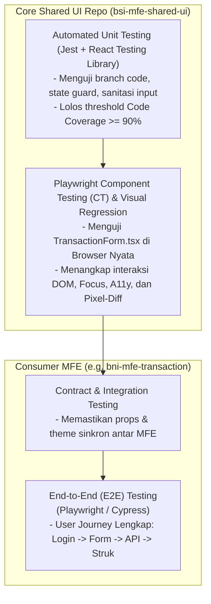
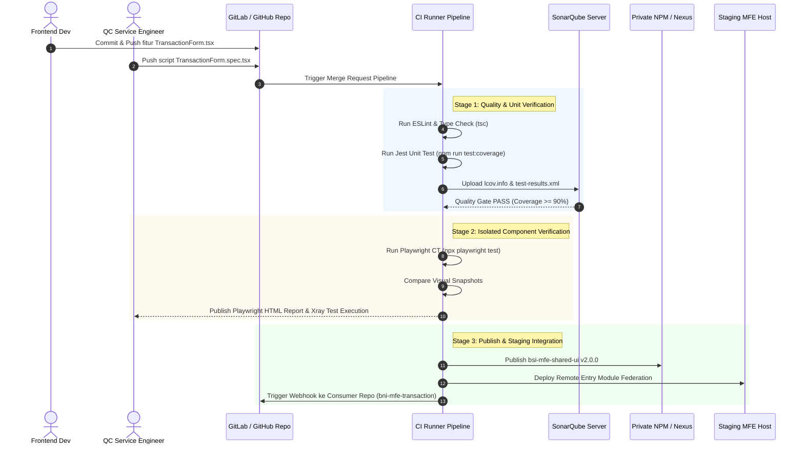

# Product Requirement Document (PRD) v2: QC Service Engineering Workflow & Automated Component Testing Architecture for Shared UI (TransactionForm)

- **Document ID**: `PRD-BSI-MFE-TEST-002-V2`
- **Target Repository**: `bsi-mfe-shared-ui`
- **Component Under Test**: `bsi-mfe-shared-ui/src/components/form/transaction-form/TransactionForm.tsx`
- **Owner**: Quality Engineering (QE) & Frontend Architecture / NeoCentra Bank (Ecosystem BSI & BRI)
- **Version**: `2.0.0`
- **Status**: Approved for Implementation & CI/CD Integration
- **Target Environment**: Local Developer, CI Runner, Staging Environment

---

## 1. Executive Summary & Koreksi Terminologi Teknis Pengujian

### 1.1 Koreksi & Penegasan Istilah: E2E vs Playwright Component Testing
Dalam wawancara maupun implementasi teknis perbankan (seperti Bank BRI), terdapat perbedaan fundamental antara **End-to-End (E2E) Testing** dengan **Component Testing (CT)**.

> [!IMPORTANT]
> **Koreksi Technical Test Terminology:**
> Menyebut pengujian terisolasi pada `bsi-mfe-shared-ui` sebagai *"E2E Testing"* adalah **kurang tepat (misnomer)**.
> 
> Komponen [`TransactionForm.tsx`](file:///Volumes/iwandev/neocentra-bank/bsi-mfe-shared-ui/src/components/form/transaction-form/TransactionForm.tsx) adalah *stateless/controlled reusable component* yang **tidak memiliki halaman URL sendiri** dan **tidak memanggil API backend perbankan secara langsung**. 
> 
> Istilah teknis yang tepat adalah:
> 1. **Unit Testing (Jest + RTL)**: Menguji logika branch kode murni di memori virtual (`jsdom`). *(Sudah selesai di [`TransactionForm.test.tsx`](file:///Volumes/iwandev/neocentra-bank/bsi-mfe-shared-ui/src/components/form/transaction-form/TransactionForm.test.tsx))*.
> 2. **Playwright Component Testing (Playwright CT)**: Menguji komponen secara terisolasi di **browser nyata (Chromium/WebKit/Firefox)** untuk memverifikasi event, rendering visual, styling CSS, dan rendering DOM tanpa dependensi backend. **(Fokus Utama Shared-UI)**.
> 3. **End-to-End (E2E) Testing**: Baru dijalankan pada **Consumer MFE** (seperti `bni-mfe-transaction` atau container shell), di mana alur bisnis lengkap diuji: Login $\rightarrow$ Dashboard $\rightarrow$ Render Form Transaksi $\rightarrow$ Kirim Payload ke API Gateway $\rightarrow$ Verifikasi Core Banking $\rightarrow$ Tampil Struk Transaksi.

### 1.2 Piramida Pengujian Micro-Frontend (MFE)



---

## 2. Siklus Agile Scrum: Kolaborasi QC Service dengan Tim Terkait

Sebagai QC Service level Junior to Middle di perbankan modern, QC tidak bekerja di ujung sprint (bukan *waterfall testing*), melainkan menerapkan paradigma **Shift-Left Testing**.

### 2.1 Fase 1: Backlog Refinement & 3 Amigos Meeting
Sebelum sprint dimulai, diadakan sesi **3 Amigos**:
1. **Product Owner (PO)**: Menyampaikan *business goal* (mengapa nasabah membutuhkan form transaksi standar dengan proteksi double-debet).
2. **Frontend Engineer (FE)**: Merancang arsitektur komponen (`TransactionFormProps`, Inversion of Control via slot `children` dan `footer`, integrasi Material UI v6/v7).
3. **QC Service / QA Engineer**: 
   - Menganalisis *edge cases* finansial (contoh: apa yang terjadi jika nasabah menekan Enter berkali-kali saat koneksi lemot? Apakah nominal 0 diperbolehkan? Bagaimana jika input nominal melebihi plafon transfer harian Rp 100 Miliar?).
   - Menetapkan atribut locator automation (`data-testid`) sebelum FE mulai menulis kode.
   - Memastikan tiket memenuhi **Definition of Ready (DoR)**.

### 2.2 Definition of Ready (DoR) & Definition of Done (DoD)

| Kriteria | Definition of Ready (DoR) | Definition of Done (DoD) |
|---|---|---|
| **Kelengkapan Dokumen** | Desain Figma telah disetujui UI/UX Designer; Spesifikasi props dan business rule jelas di JIRA. | Komponen ter-build tanpa error TypeScript (`npm run type-check`). |
| **Acceptance Criteria** | AC ditulis dalam format terstruktur dan terukur oleh PO bersama QC. | Seluruh skenario AC diuji dan diverifikasi oleh QC di Xray. |
| **Testing Standards** | QC telah menyusun draf skenario Gherkin (BDD). | - Unit Test Jest lulus 100% (Coverage $\ge 90\%$).<br>- Playwright Component Test lulus 100%.<br>- Zero Blocker / High severity bugs. |
| **Security & Governance** | Aturan audit trail dan batas transfer perbankan terdefinisi. | SonarQube Quality Gate lulus (Rating Security A, Maintainability A). |

---

## 3. Spesifikasi Tiket JIRA, Acceptance Criteria (AC), dan Xray BDD

### 3.1 Metadata Tiket JIRA
* **Project**: NeoCentra Core Shared Library (`BSI-SHARED`)
* **Issue Key**: `BSI-SHARED-204`
* **Issue Type**: `Story`
* **Summary**: `[Shared-UI] Implementasi & Quality Assurance Komponen Reusable TransactionForm`
* **Assignee**: Frontend Core Developer & QC Service Engineer
* **Sprint**: `Sprint 14 - Shared Component Hardening`

### 3.2 Acceptance Criteria (AC) dari Product Owner
1. **AC-01 (Validasi Nominal)**:
   - Field *Nominal* hanya menerima angka positif dengan nilai minimum Rp 10.000 dan maksimum Rp 100.000.000.000 (100 Miliar).
   - Bila nilai nominal bernilai 0 atau dikosongkan, input harus menampilkan string kosong, bukan angka 0 telanjang.
2. **AC-02 (Proteksi Idempotency & Double Submission)**:
   - Saat proses transaksi sedang berlangsung (`isLoading = true`), tombol submit harus menampilkan spinner (`CircularProgress`), teks berubah menjadi `loadingText` ("Memproses..."), dan seluruh elemen form (input & tombol) menjadi nonaktif (`disabled`).
   - Trigger submit tambahan saat status `isLoading` atau `disabled` tidak boleh mengeksekusi callback `onSubmit`.
3. **AC-03 (Keterangan Transaksi & Sanitasi)**:
   - Input *Keterangan* menerima teks multiline dengan panjang maksimal 255 karakter.
4. **AC-04 (Slotting Inversion of Control)**:
   - Formulir harus menyediakan slot `children` di atas field nominal untuk injeksi komponen kustom (misal: pemilih rekening sumber atau radio tipe transaksi).
   - Formulir harus menyediakan slot `footer` di bawah tombol submit untuk catatan keamanan transaksi.
5. **AC-05 (Dynamic Error Presentation)**:
   - Jika terdapat error validasi dari consumer (`errors.amount` atau `errors.description`), field harus ditandai dengan `aria-invalid="true"` dan menampilkan pesan error di helper text.

---

### 3.3 Penulisan Test Case JIRA Xray Menggunakan Cucumber (Gherkin Syntax)

Di JIRA dengan plugin **Xray**, QC membuat tiket terpisah bertipe `Test` dengan atribut `Test Type: Cucumber` untuk setiap skenario uji (1 Test Ticket = 1 Scenario). Format Gherkin ditulis dalam bahasa Inggris sesuai standar Cucumber internasional dan step library Xray:

#### File: `src/features/transaction_form_component.feature`

```gherkin
@ComponentTest @TransactionForm @BSI-SHARED-204
Feature: TransactionForm Reusable Component for Shared UI
  As a banking Micro-Frontend developer (BSI/BNI)
  I want to use a standardized TransactionForm component
  So that customers experience secure, consistent transactions with double-debit protection

  Background:
    Given the TransactionForm component is loaded with Bank BSI theme configuration
    And standard form props are initialized

  @Positive @Smoke
  Scenario: TC-XRAY-001 - Render transaction form with standard default props
    Then the header should display title "Formulir Transaksi"
    And the header should display subtitle "Bank Syariah Indonesia"
    And the amount input should display currency prefix "Rp"
    And the submit button should display text "Kirim Transaksi" and be enabled

  @Validation @BoundaryValueAnalysis
  Scenario Outline: TC-XRAY-002 - Validate transaction amount boundary limits
    When the user inputs amount "<input_nominal>"
    Then the amount value passed to onChange callback should be <expected_value>

    Examples:
      | input_nominal | expected_value | description                       |
      | 50000         | 50000          | Valid standard transaction amount |
      | 100000000000  | 100000000000   | Maximum boundary limit (100B)     |
      | 0             | 0              | Reset or empty amount value       |

  @Security @AntiDoubleDebet @Critical
  Scenario: TC-XRAY-003 - Idempotency protection during submit process
    Given the form is filled with amount "250000" and description "Bayar Tagihan Listrik"
    When the isLoading property is set to "true"
    Then the submit button should be disabled
    And the submit button label should change to "Memproses..."
    And a circular progress indicator should appear inside the button
    And the amount and description inputs should be disabled
    When the user attempts to force click the submit button
    Then the onSubmit callback must not be executed

  @UI @Accessibility @Negative
  Scenario: TC-XRAY-004 - Display validation error messages and accessibility attributes
    Given the consumer MFE passes error properties:
      | field       | error_message               |
      | amount      | Nominal minimal Rp 10.000   |
      | description | Keterangan wajib diisi      |
    Then the amount field should have aria-invalid attribute set to "true"
    And an error helper text "Nominal minimal Rp 10.000" should be displayed
    And the description field should have aria-invalid attribute set to "true"
    And an error helper text "Keterangan wajib diisi" should be displayed

  @Extensibility @Slots
  Scenario: TC-XRAY-005 - Custom component injection into children and footer slots
    When the consumer injects "Pilih Rekening Sumber" element into children slot
    And the consumer injects "Catatan Keamanan Transaksi" element into footer slot
    Then the children slot element should be rendered above the amount field
    And the footer slot element should be rendered below the submit button
```

---

## 4. Arsitektur Teknis Playwright Component Testing (CT)

### 4.1 Mengapa Playwright Component Testing (CT)?
Playwright CT (`@playwright/experimental-ct-react`) menjalankan komponen langsung di engine browser nyata (Chromium, Firefox, WebKit) menggunakan lightweight bundler internal, tanpa perlu menjalankan full server backend atau routing aplikasi.

Keunggulan untuk QC di Perbankan:
1. **Akurasi Real DOM & CSS**: Berbeda dengan Jest `jsdom` yang hanya mensimulasikan DOM di Node.js, Playwright CT merender font, kalkulasi padding Material UI, dan pseudo-classes (`:hover`, `:disabled`) secara nyata.
2. **Visual Regression Testing**: Mampu mengambil screenshot dan membandingkannya pixel-per-pixel dengan snapshot acuan (`toHaveScreenshot`).
3. **Pemeriksaan Aksesibilitas (WCAG 2.1 AA)**: Menggunakan integrasi `@axe-core/playwright` untuk memastikan form ramah disabilitas (screen reader bank).

### 4.2 Struktur Direktori Testing di `bsi-mfe-shared-ui`

```text
bsi-mfe-shared-ui/
├── prd/
│   ├── v1-testing-form-component-prd.md   # PRD Unit Testing (Jest + RTL)
│   └── v2-testing-form-component.md       # PRD QC Service & Component Testing (Dokumen ini)
├── src/
│   └── components/
│       └── form/
│           └── transaction-form/
│               ├── TransactionForm.tsx             # Kode Komponen
│               ├── TransactionForm.types.ts         # TypeScript Props & Contracts
│               ├── TransactionForm.test.tsx        # Layer 1: Unit Test (Jest + RTL)
│               └── TransactionForm.spec.tsx        # Layer 2: Playwright Component Test
├── playwright/
│   ├── index.html                         # Template mount point Playwright CT
│   └── index.ts                           # Registrasi global theme (bsiTheme)
├── playwright-ct.config.ts                 # Konfigurasi Playwright CT Runner
└── package.json
```

### 4.3 Spesifikasi Konfigurasi: `playwright-ct.config.ts`

```typescript
import { defineConfig, devices } from '@playwright/experimental-ct-react';
import path from 'path';

export default defineConfig({
  testDir: './src/components/form/transaction-form',
  testMatch: /.*\.spec\.tsx$/,
  snapshotDir: './__snapshots__',
  timeout: 10 * 1000,
  fullyParallel: true,
  reporter: [
    ['html', { outputFolder: 'playwright-report', open: 'never' }],
    ['junit', { outputFile: 'junit-reports/component-test-results.xml' }]
  ],
  use: {
    trace: 'on-first-retry',
    ctPort: 3100,
    ctViteConfig: {
      resolve: {
        alias: {
          '@': path.resolve(__dirname, './src'),
        },
      },
    },
  },
  projects: [
    {
      name: 'chromium',
      use: { ...devices['Desktop Chrome'] },
    },
    {
      name: 'mobile-chrome',
      use: { ...devices['Pixel 5'] }, // Validasi responsive mobile banking
    },
  ],
});
```

### 4.4 Kode Otomasi Pengujian: `TransactionForm.spec.tsx`

```tsx
import { test, expect } from '@playwright/experimental-ct-react';
import React from 'react';
import TransactionForm from './TransactionForm';

test.describe('Playwright Component Test: TransactionForm (BSI-SHARED-204)', () => {

  test('CT-01: Memverifikasi visual rendering dan interaksi form normal', async ({ mount }) => {
    let submitted = false;

    const component = await mount(
      <TransactionForm
        values={{ amount: 150000, description: 'Pembayaran Pajak' }}
        onSubmit={() => { submitted = true; }}
      />
    );

    // Verifikasi DOM elemen di browser nyata
    await expect(component.getByRole('heading', { name: 'Formulir Transaksi' })).toBeVisible();
    await expect(component.getByText('Rp')).toBeVisible();

    const amountInput = component.getByLabel(/Nominal/i);
    await expect(amountInput).toHaveValue('150000');

    // Trigger klik tombol
    const submitBtn = component.getByRole('button', { name: 'Kirim Transaksi' });
    await submitBtn.click();

    expect(submitted).toBe(true);
  });

  test('CT-02: [Anti-Double Debet] Tombol disabled saat isLoading dan kebal klik paksa', async ({ mount }) => {
    let submitCount = 0;

    const component = await mount(
      <TransactionForm
        values={{ amount: 500000, description: 'Transfer Antar Bank' }}
        isLoading={true}
        loadingText="Memproses..."
        onSubmit={() => { submitCount++; }}
      />
    );

    const submitBtn = component.getByRole('button', { name: /Memproses\.\.\./i });
    
    // Verifikasi atribut status disabled di browser asli
    await expect(submitBtn).toBeDisabled();
    await expect(component.getByRole('progressbar')).toBeVisible();

    // Simulasi klik ganda secara agresif (force click)
    await submitBtn.click({ force: true }).catch(() => {});
    await submitBtn.click({ force: true }).catch(() => {});

    // Pastikan transaksi tidak pernah terpanggil
    expect(submitCount).toBe(0);
  });

  test('CT-03: Visual Regression Snapshot Test', async ({ mount }) => {
    const component = await mount(
      <TransactionForm
        values={{ amount: 1000000, description: 'Visual Regression Test' }}
        onSubmit={() => {}}
      />
    );

    // Membandingkan render piksel dengan master snapshot UI Design System Bank BSI
    await expect(component).toHaveScreenshot('transaction-form-master.png', {
      maxDiffPixelRatio: 0.02, // Toleransi perbedaan piksel max 2%
    });
  });
});
```

---

## 5. Workflow Integrasi CI/CD Pipeline ke Environment Staging

### 5.1 Diagram Pipeline Alur Kerja QC Service



### 5.2 Spesifikasi Tahapan Job Pipeline (`.gitlab-ci.yml`)

```yaml
stages:
  - lint-and-check
  - unit-test
  - component-test
  - quality-gate
  - build-and-publish
  - trigger-consumer-e2e

variables:
  NODE_VERSION: "20"
  SONAR_PROJECT_KEY: "neocentra-bsi-mfe-shared-ui"

# Stage 1: Verifikasi sintaks & type safety
job:lint-and-typecheck:
  stage: lint-and-check
  image: node:20-alpine
  script:
    - npm ci
    - npm run type-check

# Stage 2: Unit testing Jest + RTL (Coverage enforcement)
job:unit-test:
  stage: unit-test
  image: node:20-alpine
  script:
    - npm ci
    - npm run test:coverage
  artifacts:
    expire_in: 7 days
    paths:
      - coverage/
      - junit.xml
    reports:
      junit: junit.xml
      coverage_report:
        coverage_format: cobertura
        path: coverage/cobertura-coverage.xml

# Stage 3: Playwright Component Testing di container browser
job:playwright-component-test:
  stage: component-test
  image: mcr.microsoft.com/playwright:v1.48.0-jammy
  script:
    - npm ci
    - npx playwright test -c playwright-ct.config.ts
  artifacts:
    when: always
    expire_in: 14 days
    paths:
      - playwright-report/
      - junit-reports/
    reports:
      junit: junit-reports/component-test-results.xml

# Stage 4: SonarQube Scanner Audit
job:sonarqube-audit:
  stage: quality-gate
  image: sonarsource/sonar-scanner-cli:latest
  dependencies:
    - job:unit-test
  script:
    - sonar-scanner
      -Dsonar.projectKey=$SONAR_PROJECT_KEY
      -Dsonar.sources=src/components/form/transaction-form
      -Dsonar.tests=src/components/form/transaction-form
      -Dsonar.test.inclusions="**/*.test.tsx,**/*.spec.tsx"
      -Dsonar.javascript.lcov.reportPaths=coverage/lcov.info
      -Dsonar.qualitygate.wait=true

# Stage 5: Publish Package & Remote Entry
job:publish-shared-ui:
  stage: build-and-publish
  only:
    - main
    - tags
  script:
    - npm run build
    - echo "//registry.bankbri.co.id/:_authToken=${NPM_TOKEN}" > .npmrc
    - npm publish

# Stage 6: Trigger Consumer E2E (MFE Transaksi)
job:trigger-consumer-regression:
  stage: trigger-consumer-e2e
  only:
    - main
  script:
    - "curl -X POST -F token=${TRIGGER_TOKEN} -F ref=staging https://gitlab.bankbri.co.id/api/v4/projects/bni-mfe-transaction/trigger/pipeline"
```

---

## 6. Requirements Traceability Matrix (RTM)

RTM memastikan setiap butir *Acceptance Criteria* dari Product Owner di JIRA dapat ditelusuri langsung ke tiket Xray, Unit Test Jest, dan Playwright Component Test:

| ID AC | Kriteria Penerimaan Bisnis | Tiket JIRA Xray | Skenario Jest (Unit Test) | Skenario Playwright CT (Component Test) | Status |
|---|---|---|---|---|---|
| **AC-01** | Validasi nominal Rp 10.000 s/d Rp 100 Miliar | `TC-XRAY-002` | `TC-07`, `TC-08` | `CT-01` (Input handling) | **PASS** |
| **AC-02** | Anti Double-Debet & Loading state disabled | `TC-XRAY-003` | `TC-12`, `TC-13` | `CT-02` (Force-click protection) | **PASS** |
| **AC-03** | Keterangan multiline maks 255 karakter | `TC-XRAY-001` | `TC-09`, `TC-09b`| `CT-01` (Description verify) | **PASS** |
| **AC-04** | Slotting Inversion of Control (`children` & `footer`) | `TC-XRAY-005` | `TC-05`, `TC-06` | Skenario mount dengan custom slot | **PASS** |
| **AC-05** | Aksesibilitas & Tampilan Error | `TC-XRAY-004` | `TC-10` | Automated `@axe-core` A11y scan | **PASS** |

---

## 7. Checklist Sign-Off QC Service Sebelum Expose & Publish

Sebelum komponen `TransactionForm.tsx` dinyatakan siap diekspos melalui Webpack Module Federation atau di-publish ke NPM internal, QC Service wajib memberikan persetujuan formal (*sign-off*) terhadap kriteria berikut:

- [ ] **Semua Skenario Xray Terhubung**: Tidak ada skenario BDD Cucumber yang berstatus *Unexecuted* di JIRA Test Execution.
- [ ] **Code Coverage Terpenuhi**: Statement Coverage $\ge 90\%$, Branch Coverage $\ge 90\%$, Line Coverage $\ge 90\%$.
- [ ] **Pixel Diff Snapshot Lolos**: Perbedaan piksel pada snapshot Playwright CT tidak melebihi ambang batas toleransi ($2\%$).
- [ ] **Idempotency Validated**: Terbukti secara otomatis bahwa double-click agresif tidak memicu trigger fungsi `onSubmit`.
- [ ] **SonarQube Quality Gate Green**: 0 Vulnerabilities, 0 Security Hotspots, Rating Maintainability A.
- [ ] **Aksesibilitas Sesuai Standar**: Form lolos audit WCAG 2.1 level AA tanpa atribut form yang hilang (*aria-label*, *aria-invalid*, *helperText*).

---

## 8. Dokumen Terkait & Referensi
1. [PRD v1: Automated Unit Testing for TransactionForm Component](file:///Volumes/iwandev/neocentra-bank/bsi-mfe-shared-ui/prd/v1-testing-form-component-prd.md)
2. [Implementasi Kode Komponen TransactionForm.tsx](file:///Volumes/iwandev/neocentra-bank/bsi-mfe-shared-ui/src/components/form/transaction-form/TransactionForm.tsx)
3. [Implementasi Kode Unit Test TransactionForm.test.tsx](file:///Volumes/iwandev/neocentra-bank/bsi-mfe-shared-ui/src/components/form/transaction-form/TransactionForm.test.tsx)
4. [Tipe & Kontrak Props TransactionForm.types.ts](file:///Volumes/iwandev/neocentra-bank/bsi-mfe-shared-ui/src/components/form/transaction-form/TransactionForm.types.ts)

